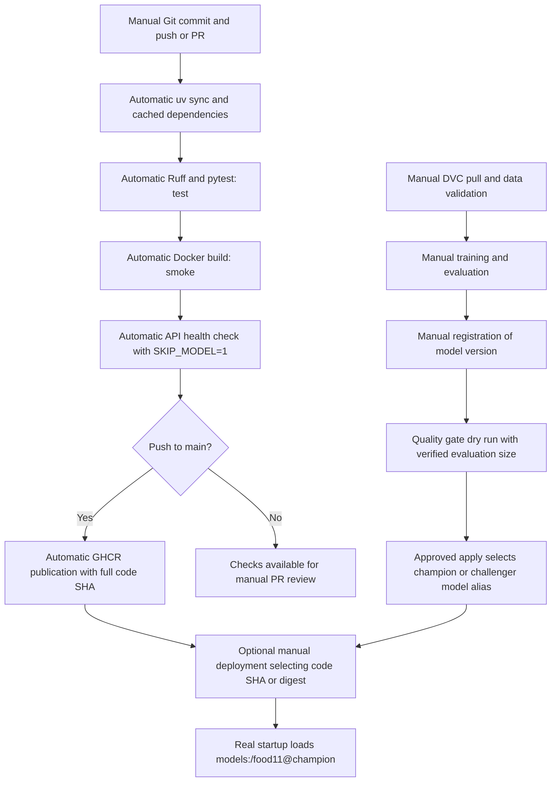

# Lab 5 — CI/CD with GitHub Actions

Implementation uses the supplied requirements: `lab5-ci-cd.md` was not present.

1. **Why avoid real MLflow in unit tests?** Loading the champion couples tests to
   server availability, registry state, network access, model artifacts, and heavy
   initialization. Tests could change behavior when an alias moves. Tests use
   `SKIP_MODEL=1` and patch the loader to fail if called.
2. **What does the fake model prove?** It verifies image upload, preprocessing shape,
   prediction invocation, logits interpretation, category mapping, and confidence
   serialization. It does not establish accuracy, artifact compatibility, registry
   connectivity, or real model inference. The generated test image is explicitly
   synthetic. The real Food-11 fixture is now present and its test runs without a skip.
3. **Why are duplicates dangerous?** Content shared between training and evaluation
   lets a classifier memorize examples and inflates accuracy. MD5 detects identical
   file contents across splits, but cannot detect re-encoded or near-duplicate images.
4. **Where should validation run?** Run it on a trusted workstation or private runner
   after `dvc pull`, before training and promotion. Public CI unit and smoke tests
   need neither data credentials nor an MLflow server. Validation is read-only.
   The distribution check compares per-class proportions in training and validation,
   using absolute differences and inclusive tolerance `tau`.
5. **What does `needs: test` do?** It makes smoke wait for successful tests. Publishing
   waits for smoke. Failed upstream checks prevent dependent jobs from running.
6. **First versus second execution time?** TODO: requires real execution. Record the
   first and second Actions job durations on comparable commits/runners. The uv cache
   reuses downloaded dependencies; BuildKit's GHA cache reuses publication build layers.
   Cache hits can reduce work, but runner startup and network conditions still vary.
7. **Why SHA tags?** The full Git SHA identifies the exact source revision of an image.
   `latest` moves and is ambiguous for rollback. Select the code by SHA (or image
   digest for immutable image identity). Select the model independently by registry
   version or alias; a SHA-tagged image using `champion` can load a different model
   after the alias moves.
8. **Token permissions?** All jobs receive `contents: read`. Only the main-push
   publication job receives `packages: write`. GHCR login uses the short-lived
   `GITHUB_TOKEN`, never a committed personal token. Pull requests cannot publish.
9. **Branch protection and failing PRs?** Manually create a rule for `main` in GitHub
   Settings → Rules → Rulesets (or branch protection). Require a pull request and
   successful `test` and `smoke` checks. Run the workflow once so checks appear in
   the selector. Disable bypass if appropriate for the course. Create a separate
   demonstration branch, add `def test_demo(): assert False`, commit and push it,
   then open a PR. Capture the failed test and blocked merge; smoke is skipped.
   Fix the test, commit and push, and capture both checks passing. Do not merge an
   intentionally broken test. TODO: requires real execution.
10. **Actual promotion decisions?** TODO: requires real execution. No real aliases
    were changed. Existing training records `test_accuracy`; new runs also record
    `test_size`. The gate uses incumbent accuracy p and computes
    `se = sqrt(p * (1-p) / n)`, promoting if candidate accuracy is at least
    `p + 2*se`, otherwise assigning `challenger`. This is the lab's approximate
    gate, not a full paired significance test. Compare runs evaluated on the same
    held-out data revision. Supply verified `--n` for historical runs lacking size;
    missing metrics or run IDs fail rather than inventing values. The script checks
    for a changed champion before writes, but registry alias updates are not atomic
    compare-and-swap: serialize real promotion operations.
    Use a table of candidate/champion version, run ID, data revision, accuracies, n,
    se, threshold, and decision when collecting actual evidence.
11. **Automate promotion with local MLflow?** Use a trusted private runner on the
    MLflow network or a local scheduled process after validation and evaluation.
    GitHub-hosted localhost refers to the runner, not your workstation. Keep
    credentials private, serialize promotions, review the dry-run result, and invoke
    `--apply` only after approval. The current CI deliberately does not train,
    register, promote, or deploy models. To collect evidence, use existing registered
    versions with comparable evaluation records, or manually train and register
    a baseline and candidate on the same DVC revision; no retraining was executed.
12. **Complete pipeline and responsibilities:**



## Local commands and remaining evidence

```bash
uv sync --frozen
uv run ruff check src tests
uv run pytest -q
uv run dvc pull
find data/food11_processed_mini/training/Bread -type f -name '*.jpg' -print -quit
# Copy the actual path printed above:
# cp 'data/food11_processed_mini/training/Bread/<actual-file>.jpg' tests/fixtures/bread.jpg
uv run pytest -q
uv run python src/food11/validate_data.py data/food11_processed_mini
docker build -t food11-api:ci .
docker run -d --name food11-lab5-smoke -p 8000:8000 -e SKIP_MODEL=1 food11-api:ci
curl --fail http://localhost:8000/health
docker logs food11-lab5-smoke
docker rm -f food11-lab5-smoke
# Set VERSION to an existing candidate and N to its verified shared evaluation size.
# Dry run only; requires the local MLflow server:
# uv run python src/food11/promote.py --version "$VERSION" --n "$N"
```

Publication, branch protection, PR evidence, cache timing measurements, and real
promotion results require manual execution. Real Food-11 validation was executed;
its duplicate failures and a separately validated clean derivative are recorded below.
No commits, pushes, GitHub setting changes, or real alias writes were performed.

References: [GitHub workflow syntax](https://docs.github.com/en/actions/reference/workflows-and-actions/workflow-syntax),
[MLflow client API](https://mlflow.org/docs/latest/api_reference/python_api/mlflow.client.html).

Read-only inspection of the local SQLite registry found `food11` version 1 as
champion, produced by run `433ecb2fd112425ba68a0ef2c9968bec`, with recorded
`test_accuracy=0.6706204379562044`. Only one registered version exists. No
`test_size` parameter was found in existing runs, and the mini dataset is absent.
Therefore n, standard error, threshold, and an actual candidate decision remain
`TODO: requires real execution`. Another existing run,
`1bd8a656153344b9b4b08da8c7156491`, records accuracy `0.6715328467153284`;
it is not a registered candidate, and comparable evaluation data must be verified
before registration or comparison. No new training is necessary if those
artifacts and evaluation provenance can be recovered; otherwise manually create
a baseline and candidate with recorded evaluation size and shared data revision.

## Verified local implementation results

- `uv add --dev pytest ruff httpx`: completed; lockfile updated.
- `uv sync --frozen`: PASS (using `UV_CACHE_DIR=/tmp/food11-uv-cache`
  because the default cache is read-only in this execution sandbox).
- `uv run ruff check src tests`: PASS.
- `uv run pytest -q`: 21 passed, 1 skipped. The skipped test needs the real
  Food-11 fixture. Tests required sandbox network permission for TestClient;
  no MLflow server or actual model was used. Dependency deprecation warnings remain.
- Temporary generated-dataset duplicate injection, detection, removal, and
  revalidation: PASS; no DVC-managed data was modified.
- `uv run python src/food11/validate_data.py data/food11_processed_mini`:
  FAIL, exit 1, because the dataset is absent.
- Workflow YAML parsing and assertions on triggers, dependencies and permissions:
  PASS. GitHub execution remains unverified.
- `git diff --check`: PASS; final status and tracked diff reviewed. New files
  were reviewed separately because plain `git diff` excludes untracked files.
- First `docker build -t food11-api:ci .`: FAIL due to PyPI download timeout
  for `packaging==26.3`; container PyPI connectivity probes subsequently returned 200.
- Fallback Docker runtime check: PASS. Started existing `food11-api:latest` with
  current `src` mounted read-only, `SKIP_MODEL=1`, and port `18005`; `/health`
  returned HTTP 200 with `{"status":"ok"}`. The temporary container was removed.
  This verifies changed source in the existing runtime, not a newly built image.

- Second `docker build -t food11-api:ci .`: FAIL due to a PyPI download
  timeout for `graphene==3.4.3` after retries. A freshly built image and its
  smoke test remain unverified. Resolve Docker Desktop build-network connectivity
  to `files.pythonhosted.org` and retry; standalone container HTTP probes worked.

## Manual GitHub execution sequence

After restoring and validating data and adding the real fixture, review changes,
then run these commands yourself (none was run by the implementation assistant):

```bash
git diff --check
git add Dockerfile README.md pyproject.toml uv.lock src/food11/deduplicate_data.py src/food11/data.py src/food11/serve.py src/food11/train.py src/food11/validate_data.py src/food11/promote.py tests lab/lab5.md .github/workflows/ci.yml
git commit -m "Implement Lab 5 CI/CD and model quality gate"
git push -u origin feature/lab5-ci-cd
gh pr create --base main --head feature/lab5-ci-cd --title "Implement Lab 5 CI/CD" --body "Add isolated tests, data validation, Docker CI/GHCR publishing, and an approval-controlled model quality gate."
```

Review the Actions results and configure the required checks manually as described
in answer 9. Once this implementation is merged, demonstrate branch protection
with a separate branch:

```bash
git switch main
git pull --ff-only
git switch -c demo/lab5-failing-ci
printf 'def test_branch_protection_demo():\n    assert False\n' > tests/test_branch_protection_demo.py
git add tests/test_branch_protection_demo.py
git commit -m "Demonstrate failing required CI check"
git push -u origin demo/lab5-failing-ci
gh pr create --base main --head demo/lab5-failing-ci --title "Demonstrate Lab 5 branch protection" --body "Intentional failure for branch protection evidence; fix before merging."
# Capture failed checks and blocked merge in GitHub before continuing.
printf 'def test_branch_protection_demo():\n    assert True\n' > tests/test_branch_protection_demo.py
git add tests/test_branch_protection_demo.py
git commit -m "Fix branch protection demonstration test"
git push
# Capture successful test and smoke checks; close the demo PR if not needed.
```

Record real CI durations, GHCR SHA tag, and PR evidence in this file. Real MLflow
promotion remains a separate, explicitly approved operation after verified data
and model-version selection. Do not pass `--apply` until that approval exists.

## Earlier follow-up local execution (2026-11-02)

- Confirmed branch `feature/lab5-ci-cd`.
- `UV_CACHE_DIR=/tmp/food11-uv-cache uv run dvc pull`: FAIL, exit 1.
  DagsHub's S3 endpoint returned HTTP 401 Unauthorized while retrieving the DVC
  directory manifest. Local credentials are present but were rejected. Refresh
  credentials privately in `.dvc/config.local` using a valid DagsHub token; do not
  commit or paste credentials into the lab report.
- No real Bread fixture could be copied because restoration failed.
- Ruff: PASS. Pytest: 21 passed, 1 skipped, 4 dependency/lifecycle deprecation
  warnings. The skipped case still requires the real Food-11 fixture.
- Real-data validation: FAIL, exit 1, because the three splits are unavailable.
- Standalone uv and minimal BuildKit probes successfully installed
  `packaging==26.3`. The full default-download build stalled and was interrupted
  (exit 130) to test a build-only adjustment: `UV_CONCURRENT_DOWNLOADS=4` and
  `UV_HTTP_TIMEOUT=120` in the existing Dockerfile. Its stages and runtime behavior
  are preserved. See [uv environment settings](https://docs.astral.sh/uv/configuration/environment/).

- Tuned `docker build -t food11-api:ci .`: PASS, exit 0. The dependency stage
  completed in 913.3 seconds, including `torch==2.14.0+cpu` and
  `torchvision==0.29.0+cpu`. No dependency version change was needed.
- Fresh-image smoke test: PASS, exit 0. Ran:

  ```bash
  docker run -d --name food11-lab5-fresh-check -p 127.0.0.1:18005:8000 -e SKIP_MODEL=1 food11-api:ci
  curl --silent --output /tmp/food11-lab5-health.json --write-out '%{http_code}' http://127.0.0.1:18005/health
  docker logs food11-lab5-fresh-check
  docker rm -f food11-lab5-fresh-check
  ```

  Retried up to 20 times with a two-second delay. Attempt 6 returned HTTP 200
  and `{"status":"ok"}`. Startup logs confirmed successful application startup;
  the temporary container was removed. No source mount or pre-existing image was
  used for this final smoke test.
- `git diff --check`: PASS. `Dockerfile.single` SHA-256 remained
  `eba857ec83f115981f19cef53bade1fc02374a22aa3e309232de469d8af48df6`.
- At the end of that attempt, valid DagsHub credentials were still needed to restore
  data, create the real fixture, and pass real-data validation. Fresh Docker build
  and smoke verification are now complete. No commits, pushes, GitHub settings
  changes, or real MLflow alias changes were performed.

## Restored real-data verification (2026-11-02)

This section supersedes the earlier missing-data and fixture limitations. The user
completed DVC pull (reported 32,033 files fetched, 36,578 added). The mini dataset
was verified locally on `feature/lab5-ci-cd`.

- Copied real `training/Bread/0_0.jpg` to `tests/fixtures/bread.jpg`, 5,087 bytes,
  RGB 128×128. SHA-256:
  `43a8d524fa9befcb74a761d82c59fb38e5052ac3915a6d650da81a1aa83d46d7`.
  Confirmed the fixture matches its source byte-for-byte.
- `UV_CACHE_DIR=/tmp/food11-uv-cache uv run ruff check src tests`: PASS.
- `UV_CACHE_DIR=/tmp/food11-uv-cache uv run pytest -q`: **24 passed, no skips**,
  4 deprecation warnings. This includes two new tests covering safe clean-copy
  behavior, evaluation preservation, source immutability, and overwrite guards.
- The mini dataset contains 3,292 images: training 1,100, evaluation 1,096,
  validation 1,096. Every class has 100 images except Rice in evaluation and
  validation, which has 96. All exceed the default minimum of 50.
- `uv run python src/food11/validate_data.py data/food11_processed_mini`:
  **FAIL, exit 1**. All structural, image readability, RGB, size, minimum-count,
  and class-proportion checks pass; only cross-split duplication fails.
- Found 43 cross-split duplicate groups, each containing two files (86 files).
  Compared bytes in addition to MD5: every pair is truly identical. All 43 pairs
  also have byte-identical counterparts in `data/food11_raw`, confirming leakage
  already exists in the source data. This is not a validator false positive or a
  resizing collision. There are 3 training/evaluation, 2 training/validation,
  and 38 evaluation/validation duplicate groups.
- Improved validator reporting to print each criterion separately, after all
  splits have been scanned. It now marks leakage in **both** affected splits;
  the earlier premature training PASS did not imply training had no duplicates.

### Complete original-dataset PASS/FAIL output

```text
PASS: training: 11 class directories
PASS: training: minimum images per class
PASS: training: readable images
PASS: training: RGB images
PASS: training: 128x128 images
FAIL: training: no cross-split duplicates
PASS: evaluation: 11 class directories
PASS: evaluation: minimum images per class
PASS: evaluation: readable images
PASS: evaluation: RGB images
PASS: evaluation: 128x128 images
FAIL: evaluation: no cross-split duplicates
PASS: validation: 11 class directories
PASS: validation: minimum images per class
PASS: validation: readable images
PASS: validation: RGB images
PASS: validation: 128x128 images
FAIL: validation: no cross-split duplicates
PASS: training/validation class proportions (tau=0.05)
FAIL: duplicate across splits: data/food11_processed_mini/evaluation/Bread/0_131.jpg and data/food11_processed_mini/training/Bread/0_106.jpg
FAIL: duplicate across splits: data/food11_processed_mini/evaluation/Bread/0_139.jpg and data/food11_processed_mini/training/Bread/0_186.jpg
FAIL: duplicate across splits: data/food11_processed_mini/evaluation/Fried food/4_123.jpg and data/food11_processed_mini/training/Fried food/4_167.jpg
FAIL: duplicate across splits: data/food11_processed_mini/validation/Bread/0_11.jpg and data/food11_processed_mini/evaluation/Bread/0_13.jpg
FAIL: duplicate across splits: data/food11_processed_mini/validation/Bread/0_129.jpg and data/food11_processed_mini/evaluation/Bread/0_138.jpg
FAIL: duplicate across splits: data/food11_processed_mini/validation/Bread/0_150.jpg and data/food11_processed_mini/evaluation/Bread/0_17.jpg
FAIL: duplicate across splits: data/food11_processed_mini/validation/Bread/0_152.jpg and data/food11_processed_mini/evaluation/Bread/0_149.jpg
FAIL: duplicate across splits: data/food11_processed_mini/validation/Bread/0_167.jpg and data/food11_processed_mini/evaluation/Bread/0_105.jpg
FAIL: duplicate across splits: data/food11_processed_mini/validation/Bread/0_174.jpg and data/food11_processed_mini/evaluation/Bread/0_1.jpg
FAIL: duplicate across splits: data/food11_processed_mini/validation/Dairy product/1_123.jpg and data/food11_processed_mini/training/Dairy product/1_185.jpg
FAIL: duplicate across splits: data/food11_processed_mini/validation/Dessert/2_12.jpg and data/food11_processed_mini/evaluation/Dessert/2_14.jpg
FAIL: duplicate across splits: data/food11_processed_mini/validation/Dessert/2_120.jpg and data/food11_processed_mini/evaluation/Dessert/2_112.jpg
FAIL: duplicate across splits: data/food11_processed_mini/validation/Dessert/2_129.jpg and data/food11_processed_mini/evaluation/Dessert/2_117.jpg
FAIL: duplicate across splits: data/food11_processed_mini/validation/Dessert/2_132.jpg and data/food11_processed_mini/evaluation/Dessert/2_129.jpg
FAIL: duplicate across splits: data/food11_processed_mini/validation/Dessert/2_133.jpg and data/food11_processed_mini/evaluation/Dessert/2_134.jpg
FAIL: duplicate across splits: data/food11_processed_mini/validation/Dessert/2_141.jpg and data/food11_processed_mini/evaluation/Dessert/2_139.jpg
FAIL: duplicate across splits: data/food11_processed_mini/validation/Dessert/2_150.jpg and data/food11_processed_mini/evaluation/Dessert/2_158.jpg
FAIL: duplicate across splits: data/food11_processed_mini/validation/Dessert/2_154.jpg and data/food11_processed_mini/training/Dessert/2_1046.jpg
FAIL: duplicate across splits: data/food11_processed_mini/validation/Dessert/2_155.jpg and data/food11_processed_mini/evaluation/Dessert/2_160.jpg
FAIL: duplicate across splits: data/food11_processed_mini/validation/Dessert/2_164.jpg and data/food11_processed_mini/evaluation/Dessert/2_166.jpg
FAIL: duplicate across splits: data/food11_processed_mini/validation/Dessert/2_176.jpg and data/food11_processed_mini/evaluation/Dessert/2_174.jpg
FAIL: duplicate across splits: data/food11_processed_mini/validation/Dessert/2_18.jpg and data/food11_processed_mini/evaluation/Dessert/2_16.jpg
FAIL: duplicate across splits: data/food11_processed_mini/validation/Fried food/4_103.jpg and data/food11_processed_mini/evaluation/Fried food/4_147.jpg
FAIL: duplicate across splits: data/food11_processed_mini/validation/Fried food/4_13.jpg and data/food11_processed_mini/evaluation/Fried food/4_159.jpg
FAIL: duplicate across splits: data/food11_processed_mini/validation/Meat/5_107.jpg and data/food11_processed_mini/evaluation/Meat/5_166.jpg
FAIL: duplicate across splits: data/food11_processed_mini/validation/Meat/5_123.jpg and data/food11_processed_mini/evaluation/Meat/5_13.jpg
FAIL: duplicate across splits: data/food11_processed_mini/validation/Meat/5_174.jpg and data/food11_processed_mini/evaluation/Meat/5_119.jpg
FAIL: duplicate across splits: data/food11_processed_mini/validation/Seafood/8_102.jpg and data/food11_processed_mini/evaluation/Seafood/8_100.jpg
FAIL: duplicate across splits: data/food11_processed_mini/validation/Seafood/8_110.jpg and data/food11_processed_mini/evaluation/Seafood/8_108.jpg
FAIL: duplicate across splits: data/food11_processed_mini/validation/Seafood/8_125.jpg and data/food11_processed_mini/evaluation/Seafood/8_123.jpg
FAIL: duplicate across splits: data/food11_processed_mini/validation/Seafood/8_130.jpg and data/food11_processed_mini/evaluation/Seafood/8_134.jpg
FAIL: duplicate across splits: data/food11_processed_mini/validation/Seafood/8_133.jpg and data/food11_processed_mini/evaluation/Seafood/8_137.jpg
FAIL: duplicate across splits: data/food11_processed_mini/validation/Seafood/8_134.jpg and data/food11_processed_mini/evaluation/Seafood/8_138.jpg
FAIL: duplicate across splits: data/food11_processed_mini/validation/Seafood/8_139.jpg and data/food11_processed_mini/evaluation/Seafood/8_139.jpg
FAIL: duplicate across splits: data/food11_processed_mini/validation/Seafood/8_141.jpg and data/food11_processed_mini/evaluation/Seafood/8_140.jpg
FAIL: duplicate across splits: data/food11_processed_mini/validation/Seafood/8_167.jpg and data/food11_processed_mini/evaluation/Seafood/8_164.jpg
FAIL: duplicate across splits: data/food11_processed_mini/validation/Seafood/8_183.jpg and data/food11_processed_mini/evaluation/Seafood/8_177.jpg
FAIL: duplicate across splits: data/food11_processed_mini/validation/Seafood/8_187.jpg and data/food11_processed_mini/evaluation/Seafood/8_186.jpg
FAIL: duplicate across splits: data/food11_processed_mini/validation/Soup/9_151.jpg and data/food11_processed_mini/evaluation/Soup/9_148.jpg
FAIL: duplicate across splits: data/food11_processed_mini/validation/Soup/9_152.jpg and data/food11_processed_mini/evaluation/Soup/9_150.jpg
FAIL: duplicate across splits: data/food11_processed_mini/validation/Soup/9_166.jpg and data/food11_processed_mini/evaluation/Soup/9_162.jpg
FAIL: duplicate across splits: data/food11_processed_mini/validation/Soup/9_172.jpg and data/food11_processed_mini/evaluation/Soup/9_170.jpg
FAIL: duplicate across splits: data/food11_processed_mini/validation/Vegetable-Fruit/10_138.jpg and data/food11_processed_mini/evaluation/Vegetable-Fruit/10_106.jpg
FAIL: dataset validation
```

### Safe remediation tested without changing the DVC dataset

Added `src/food11/deduplicate_data.py`. It creates a new destination and refuses
to overwrite an existing directory or use nested source/destination paths. It
keeps the evaluation copy first, validation second, and training last, excluding
only byte-confirmed duplicates from later splits. It does not move images between
splits, relabel images, pad class counts, relax thresholds, or modify source files.

Executed:

```bash
uv run python src/food11/deduplicate_data.py data/food11_processed_mini /tmp/food11-lab5-clean-05n8bP/dataset
uv run python src/food11/validate_data.py /tmp/food11-lab5-clean-05n8bP/dataset
```

The command excluded 43 files **from the copy only**, retaining 3,249 files:
training 1,095, evaluation 1,096, validation 1,058. Evaluation is byte-for-byte
preserved. The smallest class contains 89 images, above the required 50.

Complete standalone clean-copy validation output (exit 0):

```text
PASS: training: 11 class directories
PASS: training: minimum images per class
PASS: training: readable images
PASS: training: RGB images
PASS: training: 128x128 images
PASS: training: no cross-split duplicates
PASS: evaluation: 11 class directories
PASS: evaluation: minimum images per class
PASS: evaluation: readable images
PASS: evaluation: RGB images
PASS: evaluation: 128x128 images
PASS: evaluation: no cross-split duplicates
PASS: validation: 11 class directories
PASS: validation: minimum images per class
PASS: validation: readable images
PASS: validation: RGB images
PASS: validation: 128x128 images
PASS: validation: no cross-split duplicates
PASS: training/validation class proportions (tau=0.05)
PASS: dataset validation (including class proportions)
```

Compared before/after SHA-256 manifests for all 3,292 original mini files: every
path and content hash is unchanged. `Dockerfile.single` also retained its original
SHA-256. No original DVC-managed file was changed.

The clean copy is a temporary local artifact under `/tmp`, not a new DVC revision,
not a replacement for `data/food11_processed_mini`, and not used by existing
training or serving. To reproduce, pass any new, separate destination to the
clean-copy command. Review the cleanup policy and version a derivative explicitly
before using it for training. Existing trained models may already have seen leaked
images, so fixing the copy alone does not repair their evaluation results.

**Remaining:** the original DVC revision correctly fails the leakage gate.
Publishing/adopting a reviewed clean data revision and retraining/evaluating on it
have not been performed. GitHub checks/publication, branch protection and PR
demonstration, CI timing measurements, and real model-promotion evidence remain
manual work. The restored evaluation count is 1,096, but it is not automatically
assumed to be the evaluation size of any historical MLflow run without provenance.
No commits, pushes, GitHub setting changes, or MLflow alias changes were made.

Final preservation checks: `uv run dvc status` returned **“Data and pipelines are
up to date.”** (exit 0). The sandbox-only attempt initially could not open DVC's
state database; rerunning with local state access succeeded. All 1,096 original
evaluation images were separately compared against the derivative by path and
bytes and matched. Final Ruff and `git diff --check` both passed.

Files added or updated in this restored-data step: `tests/fixtures/bread.jpg`,
`tests/fixtures/README.md`, `src/food11/validate_data.py`,
`src/food11/deduplicate_data.py`, `tests/test_deduplicate_data.py`, and this report.
At that stage the Docker image had not been rebuilt after the validator/cleanup
changes. The final verification below records the subsequent rebuild and smoke test.

## Final clean-copy review and commit preparation (2026-11-02)

The cleaned dataset remains separate at `/tmp/food11-lab5-clean-05n8bP/dataset`.
It has exactly `training`, `evaluation`, and `validation` at its root, with exactly
the same 11 Food-11 class directories in each split. The complete original-dataset
failure log above preserves all 43 duplicate pairs. Rechecked every pair against
both processed and raw bytes; all remain genuine source-data duplicates.

Cleanup keeps evaluation first, then validation, then training, dropping the
later occurrence from the derivative only. No images are moved between splits,
no labels or image bytes are changed, no samples are fabricated, and validation
thresholds stay at `--min-per-class 50 --tau 0.05`. Every retained image has the
same relative path and SHA-256 as its source; the removed paths represent exactly
one occurrence from each of the 43 duplicate pairs. This policy protects the
held-out split for future training, but does not make past trained models free
of leakage. The cleaned copy has not been adopted, DVC-tracked, pushed, or used
for training or promotion.

Reviewed class counts:

| Class | Training | Evaluation | Validation |
|---|---:|---:|---:|
| Bread | 98 | 100 | 94 |
| Dairy product | 99 | 100 | 100 |
| Dessert | 99 | 100 | 89 |
| Egg | 100 | 100 | 100 |
| Fried food | 99 | 100 | 98 |
| Meat | 100 | 100 | 97 |
| Noodles-Pasta | 100 | 100 | 100 |
| Rice | 100 | 96 | 96 |
| Seafood | 100 | 100 | 89 |
| Soup | 100 | 100 | 96 |
| Vegetable-Fruit | 100 | 100 | 99 |
| **Total** | **1,095** | **1,096** | **1,058** |

All 1,096 evaluation images are preserved byte-for-byte, with identical paths.
All 3,292 original mini-dataset files match the pre-cleaning SHA-256 manifest;
`uv run dvc status` reports “Data and pipelines are up to date.” The `/tmp` copy
is temporary and reproducible using the cleanup command above; no dataset is
included in the proposed Git commit except the 5,087-byte real Bread test fixture.

Manifest fingerprints (SHA-256 of sorted JSON mapping relative paths to file
SHA-256 digests, using Python `json.dumps(manifest, sort_keys=True)`):

- Original: `dba71f538e0a8c5caa8e4c0e18ea2174c7697116a49c0c9f3169d907f4193418`.
- Clean copy: `4893d5a88aa8e66bf9702e64ece4b8210205fac4282692c80afde6427703786e`.

Final commands executed (uv uses `/tmp/food11-uv-cache` in this sandbox):

- `uv sync --frozen`: PASS.
- `uv run ruff check src tests`: PASS.
- `uv run pytest -q`: **24 passed, no skips**, 4 deprecation warnings.
- `uv run python src/food11/validate_data.py /tmp/food11-lab5-clean-05n8bP/dataset`:
  PASS for all criteria and all splits, exit 0.
- Workflow YAML and embedded Bash syntax checks: PASS; triggers, dependencies,
  main-only publication condition and token permissions checked locally.
- `uv run dvc status`: PASS; original data unchanged.
- `docker build -t food11-api:ci .`: PASS, exit 0; rebuilt after the validator
  and cleanup additions, reusing the frozen dependency layer.
- Fresh rebuilt-image smoke test: PASS, exit 0. Started with
  `docker run -d --name food11-lab5-final-smoke -p 127.0.0.1:18005:8000 -e SKIP_MODEL=1 food11-api:ci`.
  The 20-attempt/two-second retry loop returned HTTP 200 on attempt 7, body
  `{"status":"ok"}`. Startup completed successfully; logs were inspected and
  the temporary container was removed. No source mount or model server was used.
- `git diff --check` and final staged-diff checks: PASS.
- `Dockerfile.single` remains untouched, SHA-256
  `eba857ec83f115981f19cef53bade1fc02374a22aa3e309232de469d8af48df6`.

The original DVC revision still correctly fails leakage validation. A separate
approval is needed to adopt/version a clean dataset. GitHub CI execution, GHCR
publication, branch protection and the failing/passing PR demonstration, CI timing
measurements, and real MLflow promotion evidence remain incomplete. No real
MLflow aliases or GitHub settings were changed.

Proposed commit title: `Implement Lab 5 CI/CD and model quality gate`.
After reviewing the staged diff and obtaining commit/push approval, run manually:

```bash
git switch feature/lab5-ci-cd
git diff --cached --check
git diff --cached --stat
git diff --cached
git commit -m "Implement Lab 5 CI/CD and model quality gate"
git push -u origin feature/lab5-ci-cd
```

These commit and push commands are proposals only; neither was executed.

The proposed commit stages 19 Lab 5 files: `.github/workflows/ci.yml`, `Dockerfile`,
`README.md`, `pyproject.toml`, `uv.lock`, `lab/lab5.md`, `src/food11/data.py`,
`src/food11/serve.py`, `src/food11/train.py`, `src/food11/validate_data.py`,
`src/food11/deduplicate_data.py`, `src/food11/promote.py`, `tests/test_data.py`,
`tests/test_api.py`, `tests/test_validate_data.py`, `tests/test_deduplicate_data.py`,
`tests/test_promote.py`, `tests/fixtures/README.md`, and `tests/fixtures/bread.jpg`.
`Dockerfile.single` remains untracked and excluded. No original or cleaned DVC
images, data pointers, credentials, or MLflow artifacts are staged. Preparing the
index does not create a commit; HEAD remains unchanged.
