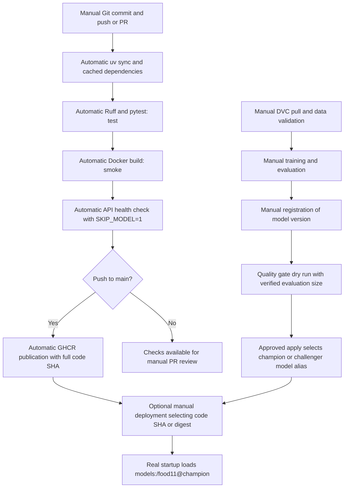

# Lab 5 — CI/CD with GitHub Actions

Implementation uses the supplied requirements: `lab5-ci-cd.md` was not present.

## Current verified state — final submission (2026-11-03)

- Original implementation `b070cb69f185072b751cd1d668c74b8dbdb701d1` was committed
  and pushed. Its [GitHub Actions run](https://github.com/ayaelkhalil1015/mlops-lab-1/actions/runs/41484869788)
  passed `test` (24 tests) and `smoke`; publication was correctly skipped on the
  feature branch. Older “not committed/pushed” and missing-data statements below
  describe earlier attempts, not the current state.
- Final review fixes now use a Docker context allowlist, bounded smoke requests,
  MLflow health-based Compose readiness, and evaluation revision checks.
- Local Ruff, frozen sync and **34 tests** pass. Both actual and synthetic Docker
  context exports exclude credential files. Image build passes. Final smoke and
  Compose evidence is recorded in the final-fix verification section below.
- Original DVC data stays unchanged: 3,292 images with **43 cross-split duplicate
  pairs**, all retained in the complete failure evidence below. The separate
  `/tmp/lab5-q10-20261103/dataset` derivative has 3,249 images, all 11 classes
  in all three splits, and preserves every one of the 1,096 evaluation images.
- **Question 6 is complete** with two exact-commit CI attempts and measured
  step/cache evidence; no cache-driven speedup is claimed. **Question 10 now has
  actual CPU training, comparable fresh evaluations, isolated versions and dry-run
  decisions** (see 2026-11-03 results below). **Question 9 is complete**: PR #1
  demonstrated a blocked merge with a failing check, then successful checks after
  restoring the assertion; PR #1 is now closed without merging and its evidence
  remains below. PR #2 was merged normally into main; the main workflow passed
  all three jobs and published the merge-SHA image to GHCR. See the final
  publication verification section. No manual image publication or real
  promotion was run.


The dated sections below form an execution history. Statements that an action
was pending or had not yet been executed describe that section's checkpoint;
the current summary and final submission section take precedence. The complete
43 duplicate-pair records and failing/passing CI evidence are intentionally retained.

## Lab questions

1. **Why avoid real MLflow in unit tests?** Loading the champion couples tests to
   server availability, registry state, network access, model artifacts, and heavy
   initialization. Tests could change behavior when an alias moves. Tests use
   `SKIP_MODEL=1` and patch the loader to fail if called.
2. **What does the fake model prove?** It verifies image upload, preprocessing shape,
   prediction invocation, logits interpretation, category mapping, and confidence
   serialization. It does not establish accuracy, artifact compatibility, registry
   connectivity, or real model inference. The generated test image is explicitly
   synthetic. The real Food-11 fixture is now present and its test runs without a skip.
3. **Why are duplicates dangerous?** Content shared between training and evaluation
   lets a classifier memorize examples and inflates accuracy. MD5 detects identical
   file contents across splits, but cannot detect re-encoded or near-duplicate images.
4. **Where should validation run?** Run it on a trusted workstation or private runner
   after `dvc pull`, before training and promotion. Public CI unit and smoke tests
   need neither data credentials nor an MLflow server. Validation is read-only.
   The distribution check compares per-class proportions in training and validation,
   using absolute differences and inclusive tolerance `tau`.
5. **What does `needs: test` do?** It makes smoke wait for successful tests. Publishing
   waits for smoke. Failed upstream checks prevent dependent jobs from running.
6. **First versus second execution time?** **Completed with measured execution.**
   Compared attempts 1 and 2 of CI run `41495964607` at the exact same commit
   `9dd2acf`, with unchanged workflow, uv.lock and 34 tests. `test` took **35 s in
   both** attempts; `smoke` took **127 s → 128 s**. `setup-uv` (including restore)
   stayed **2 s → 2 s** and `uv sync --frozen` changed **6 s → 5 s**. Both attempts
   restored the same 315,451-byte pruned dependency cache and still downloaded
   wheels, including PyTorch, and prepared/installed 173 packages. Thus the cache
   restoration works, but this warm-cache pair does **not** establish cache-driven
   acceleration. The test job did not get faster and the workflow span increased
   from 164 s to 168 s. Caching can reuse eligible files; it does not guarantee a
   faster run or restore the complete virtual environment. The full measured
   per-step table, immutable attempt/job links, limitations and log evidence are
   recorded in the Question 6 experiment below.
7. **Why SHA tags?** The full Git SHA identifies the exact source revision of an image.
   `latest` moves and is ambiguous for rollback. Select the code by SHA (or image
   digest for immutable image identity). Select the model independently by registry
   version or alias; a SHA-tagged image using `champion` can load a different model
   after the alias moves.
8. **Token permissions?** All jobs receive `contents: read`. Only the main-push
   publication job receives `packages: write`. GHCR login uses the short-lived
   `GITHUB_TOKEN`, never a committed personal token. Pull requests cannot publish.
9. **Branch protection and failing PRs?** **Completed with real execution.**
   Existing main rules require a pull request and successful `test` and `smoke`
   checks. [Temporary PR #1](https://github.com/ayaelkhalil1015/mlops-lab-1/pull/1)
   was opened from `test/lab5-failing-ci` into `main`, based on the latest feature
   commit. Changing only `assert len(CLASSES) == 11` to `== 12` produced one failed
   test and 33 passes. The PR's `test` check failed, `smoke` was skipped, and GitHub
   reported `mergeStateStatus: BLOCKED` while `mergeable: MERGEABLE` and draft was
   false. Thus the block was not a draft/conflict artifact. Restoring 11 on the
   same branch produced 34 passing tests and successful Docker/smoke checks.
   GitHub then reported `mergeStateStatus: CLEAN`. No merge or bypass was attempted.
   Main and its rules were unchanged. Full commit/run evidence is recorded below.
10. **Actual promotion decisions?** The approved isolated experiment is complete:
    fresh baseline 735/1,096 (67.0620%); candidate A, isolated v2, 499/1,096
    (45.5292%) -> challenger; newly trained candidate B, isolated v3, 856/1,096
    (78.1022%) -> qualifies as champion in dry-run. SE=0.014196504984959725;
    threshold=0.6990134479261239. All three fresh runs record the same actual
    evaluation revision and n=1,096. No production aliases changed, and the isolated
    baseline alias remains v1. Full run IDs, training/selection evidence and
    historical-leakage limitations are below. New runs record
    `test_size`. The gate uses incumbent accuracy p and computes
    `se = sqrt(p * (1-p) / n)`, promoting if candidate accuracy is at least
    `p + 2*se`, otherwise assigning `challenger`. This is the lab's approximate
    gate, not a full paired significance test. Compare runs evaluated on the same
    held-out data revision. New runs record `evaluation_revision` (content and
    label/path SHA-256). The gate rejects differing revisions; missing provenance
    allows a clearly marked numerical dry-run only and blocks `--apply`.
    Supply verified `--n` for historical runs lacking size;
    missing metrics or run IDs fail rather than inventing values. The script checks
    for a changed champion before writes, but registry alias updates are not atomic
    compare-and-swap: simultaneous promotion operations **require coordination**,
    such as one shared external lock/queue across all operators and runners.
    A single-process recheck is not a distributed lock.
    Use a table of candidate/champion version, run ID, data revision, accuracies, n,
    se, threshold, and decision when collecting actual evidence.
11. **Automate promotion with local MLflow?** Use a trusted private runner on the
    MLflow network or a local scheduled process after validation and evaluation.
    GitHub-hosted localhost refers to the runner, not your workstation. Keep
    credentials private, serialize promotions, review the dry-run result, and invoke
    `--apply` only after approval. The current CI deliberately does not train,
    register, promote, or deploy models. To collect evidence, use existing registered
    versions with comparable evaluation records, or manually train and register
    a baseline and candidate on the same verified data revision. The approved
    Question 10 CPU experiment was run in isolation; production promotion was not.
12. **Complete pipeline and responsibilities:**



## Local commands and remaining evidence

```bash
uv sync --frozen
uv run ruff check src tests
uv run pytest -q
uv run dvc pull
find data/food11_processed_mini/training/Bread -type f -name '*.jpg' -print -quit
# Copy the actual path printed above:
# cp 'data/food11_processed_mini/training/Bread/<actual-file>.jpg' tests/fixtures/bread.jpg
uv run pytest -q
uv run python src/food11/validate_data.py data/food11_processed_mini
docker build -t food11-api:ci .
docker run -d --name food11-lab5-smoke -p 8000:8000 -e SKIP_MODEL=1 food11-api:ci
curl --fail http://localhost:8000/health
docker logs food11-lab5-smoke
docker rm -f food11-lab5-smoke
# Set VERSION to an existing candidate and N to its verified shared evaluation size.
# Dry run only; requires the local MLflow server:
# uv run python src/food11/promote.py --version "$VERSION" --n "$N"
```

Publication, branch protection, PR evidence, cache timing, data validation and
the isolated model experiment have now been executed; see the dated evidence below.
Real production alias writes were not performed. The published GHCR image still
lacks a successful local pull/health verification because of the documented slow
transfer. The following historical sections retain earlier attempts and failures.

References: [GitHub workflow syntax](https://docs.github.com/en/actions/reference/workflows-and-actions/workflow-syntax),
[MLflow client API](https://mlflow.org/docs/latest/api_reference/python_api/mlflow.client.html).

## Historical record — initial implementation before commit b070cb6

The following attempts are historical and are superseded by the current status
and final-fix verification sections. Failure evidence is retained intentionally.

Read-only inspection of the local SQLite registry found `food11` version 1 as
champion, produced by run `433ecb2fd112425ba68a0ef2c9968bec`, with recorded
`test_accuracy=0.6706204379562044`. Only one registered version exists. No
`test_size` parameter was found in existing runs, and the mini dataset is absent.
Therefore n, standard error, threshold, and an actual candidate decision remain
`TODO: requires real execution`. Another existing run,
`1bd8a656153344b9b4b08da8c7156491`, records accuracy `0.6715328467153284`;
it is not a registered candidate, and comparable evaluation data must be verified
before registration or comparison. No new training is necessary if those
artifacts and evaluation provenance can be recovered; otherwise manually create
a baseline and candidate with recorded evaluation size and shared data revision.

### Initial local implementation attempts (historical)

- `uv add --dev pytest ruff httpx`: completed; lockfile updated.
- `uv sync --frozen`: PASS (using `UV_CACHE_DIR=/tmp/food11-uv-cache`
  because the default cache is read-only in this execution sandbox).
- `uv run ruff check src tests`: PASS.
- `uv run pytest -q`: 21 passed, 1 skipped. The skipped test needs the real
  Food-11 fixture. Tests required sandbox network permission for TestClient;
  no MLflow server or actual model was used. Dependency deprecation warnings remain.
- Temporary generated-dataset duplicate injection, detection, removal, and
  revalidation: PASS; no DVC-managed data was modified.
- `uv run python src/food11/validate_data.py data/food11_processed_mini`:
  FAIL, exit 1, because the dataset is absent.
- Workflow YAML parsing and assertions on triggers, dependencies and permissions:
  PASS. GitHub execution remains unverified.
- `git diff --check`: PASS; final status and tracked diff reviewed. New files
  were reviewed separately because plain `git diff` excludes untracked files.
- First `docker build -t food11-api:ci .`: FAIL due to PyPI download timeout
  for `packaging==26.3`; container PyPI connectivity probes subsequently returned 200.
- Fallback Docker runtime check: PASS. Started existing `food11-api:latest` with
  current `src` mounted read-only, `SKIP_MODEL=1`, and port `18005`; `/health`
  returned HTTP 200 with `{"status":"ok"}`. The temporary container was removed.
  This verifies changed source in the existing runtime, not a newly built image.

- Second `docker build -t food11-api:ci .`: FAIL due to a PyPI download
  timeout for `graphene==3.4.3` after retries. A freshly built image and its
  smoke test remain unverified. Resolve Docker Desktop build-network connectivity
  to `files.pythonhosted.org` and retry; standalone container HTTP probes worked.

### Original proposed GitHub sequence (historical)

After restoring and validating data and adding the real fixture, review changes,
then run these commands yourself (none was run by the implementation assistant):

```bash
git diff --check
git add Dockerfile README.md pyproject.toml uv.lock src/food11/deduplicate_data.py src/food11/data.py src/food11/serve.py src/food11/train.py src/food11/validate_data.py src/food11/promote.py tests lab/lab5.md .github/workflows/ci.yml
git commit -m "Implement Lab 5 CI/CD and model quality gate"
git push -u origin feature/lab5-ci-cd
gh pr create --base main --head feature/lab5-ci-cd --title "Implement Lab 5 CI/CD" --body "Add isolated tests, data validation, Docker CI/GHCR publishing, and an approval-controlled model quality gate."
```

Review the Actions results and configure the required checks manually as described
in answer 9. Once this implementation is merged, demonstrate branch protection
with a separate branch:

```bash
git switch main
git pull --ff-only
git switch -c demo/lab5-failing-ci
printf 'def test_branch_protection_demo():\n    assert False\n' > tests/test_branch_protection_demo.py
git add tests/test_branch_protection_demo.py
git commit -m "Demonstrate failing required CI check"
git push -u origin demo/lab5-failing-ci
gh pr create --base main --head demo/lab5-failing-ci --title "Demonstrate Lab 5 branch protection" --body "Intentional failure for branch protection evidence; fix before merging."
# Capture failed checks and blocked merge in GitHub before continuing.
printf 'def test_branch_protection_demo():\n    assert True\n' > tests/test_branch_protection_demo.py
git add tests/test_branch_protection_demo.py
git commit -m "Fix branch protection demonstration test"
git push
# Capture successful test and smoke checks; close the demo PR if not needed.
```

Record real CI durations, GHCR SHA tag, and PR evidence in this file. Real MLflow
promotion remains a separate, explicitly approved operation after verified data
and model-version selection. Do not pass `--apply` until that approval exists.

### Earlier follow-up execution (historical, 2026-11-02)

- Confirmed branch `feature/lab5-ci-cd`.
- `UV_CACHE_DIR=/tmp/food11-uv-cache uv run dvc pull`: FAIL, exit 1.
  DagsHub's S3 endpoint returned HTTP 401 Unauthorized while retrieving the DVC
  directory manifest. Local credentials are present but were rejected. Refresh
  credentials privately in `.dvc/config.local` using a valid DagsHub token; do not
  commit or paste credentials into the lab report.
- No real Bread fixture could be copied because restoration failed.
- Ruff: PASS. Pytest: 21 passed, 1 skipped, 4 dependency/lifecycle deprecation
  warnings. The skipped case still requires the real Food-11 fixture.
- Real-data validation: FAIL, exit 1, because the three splits are unavailable.
- Standalone uv and minimal BuildKit probes successfully installed
  `packaging==26.3`. The full default-download build stalled and was interrupted
  (exit 130) to test a build-only adjustment: `UV_CONCURRENT_DOWNLOADS=4` and
  `UV_HTTP_TIMEOUT=120` in the existing Dockerfile. Its stages and runtime behavior
  are preserved. See [uv environment settings](https://docs.astral.sh/uv/configuration/environment/).

- Tuned `docker build -t food11-api:ci .`: PASS, exit 0. The dependency stage
  completed in 913.3 seconds, including `torch==2.14.0+cpu` and
  `torchvision==0.29.0+cpu`. No dependency version change was needed.
- Fresh-image smoke test: PASS, exit 0. Ran:

  ```bash
  docker run -d --name food11-lab5-fresh-check -p 127.0.0.1:18005:8000 -e SKIP_MODEL=1 food11-api:ci
  curl --silent --output /tmp/food11-lab5-health.json --write-out '%{http_code}' http://127.0.0.1:18005/health
  docker logs food11-lab5-fresh-check
  docker rm -f food11-lab5-fresh-check
  ```

  Retried up to 20 times with a two-second delay. Attempt 6 returned HTTP 200
  and `{"status":"ok"}`. Startup logs confirmed successful application startup;
  the temporary container was removed. No source mount or pre-existing image was
  used for this final smoke test.
- `git diff --check`: PASS. `Dockerfile.single` SHA-256 remained
  `eba857ec83f115981f19cef53bade1fc02374a22aa3e309232de469d8af48df6`.
- At the end of that attempt, valid DagsHub credentials were still needed to restore
  data, create the real fixture, and pass real-data validation. Fresh Docker build
  and smoke verification are now complete. No commits, pushes, GitHub settings
  changes, or real MLflow alias changes were performed.

## Restored real-data verification (2026-11-02)

This section supersedes the earlier missing-data and fixture limitations. The user
completed DVC pull (reported 32,033 files fetched, 36,578 added). The mini dataset
was verified locally on `feature/lab5-ci-cd`.

- Copied real `training/Bread/0_0.jpg` to `tests/fixtures/bread.jpg`, 5,087 bytes,
  RGB 128×128. SHA-256:
  `43a8d524fa9befcb74a761d82c59fb38e5052ac3915a6d650da81a1aa83d46d7`.
  Confirmed the fixture matches its source byte-for-byte.
- `UV_CACHE_DIR=/tmp/food11-uv-cache uv run ruff check src tests`: PASS.
- `UV_CACHE_DIR=/tmp/food11-uv-cache uv run pytest -q`: **24 passed, no skips**,
  4 deprecation warnings. This includes two new tests covering safe clean-copy
  behavior, evaluation preservation, source immutability, and overwrite guards.
- The mini dataset contains 3,292 images: training 1,100, evaluation 1,096,
  validation 1,096. Every class has 100 images except Rice in evaluation and
  validation, which has 96. All exceed the default minimum of 50.
- `uv run python src/food11/validate_data.py data/food11_processed_mini`:
  **FAIL, exit 1**. All structural, image readability, RGB, size, minimum-count,
  and class-proportion checks pass; only cross-split duplication fails.
- Found 43 cross-split duplicate groups, each containing two files (86 files).
  Compared bytes in addition to MD5: every pair is truly identical. All 43 pairs
  also have byte-identical counterparts in `data/food11_raw`, confirming leakage
  already exists in the source data. This is not a validator false positive or a
  resizing collision. There are 3 training/evaluation, 2 training/validation,
  and 38 evaluation/validation duplicate groups.
- Improved validator reporting to print each criterion separately, after all
  splits have been scanned. It now marks leakage in **both** affected splits;
  the earlier premature training PASS did not imply training had no duplicates.

### Complete original-dataset PASS/FAIL output

```text
PASS: training: 11 class directories
PASS: training: minimum images per class
PASS: training: readable images
PASS: training: RGB images
PASS: training: 128x128 images
FAIL: training: no cross-split duplicates
PASS: evaluation: 11 class directories
PASS: evaluation: minimum images per class
PASS: evaluation: readable images
PASS: evaluation: RGB images
PASS: evaluation: 128x128 images
FAIL: evaluation: no cross-split duplicates
PASS: validation: 11 class directories
PASS: validation: minimum images per class
PASS: validation: readable images
PASS: validation: RGB images
PASS: validation: 128x128 images
FAIL: validation: no cross-split duplicates
PASS: training/validation class proportions (tau=0.05)
FAIL: duplicate across splits: data/food11_processed_mini/evaluation/Bread/0_131.jpg and data/food11_processed_mini/training/Bread/0_106.jpg
FAIL: duplicate across splits: data/food11_processed_mini/evaluation/Bread/0_139.jpg and data/food11_processed_mini/training/Bread/0_186.jpg
FAIL: duplicate across splits: data/food11_processed_mini/evaluation/Fried food/4_123.jpg and data/food11_processed_mini/training/Fried food/4_167.jpg
FAIL: duplicate across splits: data/food11_processed_mini/validation/Bread/0_11.jpg and data/food11_processed_mini/evaluation/Bread/0_13.jpg
FAIL: duplicate across splits: data/food11_processed_mini/validation/Bread/0_129.jpg and data/food11_processed_mini/evaluation/Bread/0_138.jpg
FAIL: duplicate across splits: data/food11_processed_mini/validation/Bread/0_150.jpg and data/food11_processed_mini/evaluation/Bread/0_17.jpg
FAIL: duplicate across splits: data/food11_processed_mini/validation/Bread/0_152.jpg and data/food11_processed_mini/evaluation/Bread/0_149.jpg
FAIL: duplicate across splits: data/food11_processed_mini/validation/Bread/0_167.jpg and data/food11_processed_mini/evaluation/Bread/0_105.jpg
FAIL: duplicate across splits: data/food11_processed_mini/validation/Bread/0_174.jpg and data/food11_processed_mini/evaluation/Bread/0_1.jpg
FAIL: duplicate across splits: data/food11_processed_mini/validation/Dairy product/1_123.jpg and data/food11_processed_mini/training/Dairy product/1_185.jpg
FAIL: duplicate across splits: data/food11_processed_mini/validation/Dessert/2_12.jpg and data/food11_processed_mini/evaluation/Dessert/2_14.jpg
FAIL: duplicate across splits: data/food11_processed_mini/validation/Dessert/2_120.jpg and data/food11_processed_mini/evaluation/Dessert/2_112.jpg
FAIL: duplicate across splits: data/food11_processed_mini/validation/Dessert/2_129.jpg and data/food11_processed_mini/evaluation/Dessert/2_117.jpg
FAIL: duplicate across splits: data/food11_processed_mini/validation/Dessert/2_132.jpg and data/food11_processed_mini/evaluation/Dessert/2_129.jpg
FAIL: duplicate across splits: data/food11_processed_mini/validation/Dessert/2_133.jpg and data/food11_processed_mini/evaluation/Dessert/2_134.jpg
FAIL: duplicate across splits: data/food11_processed_mini/validation/Dessert/2_141.jpg and data/food11_processed_mini/evaluation/Dessert/2_139.jpg
FAIL: duplicate across splits: data/food11_processed_mini/validation/Dessert/2_150.jpg and data/food11_processed_mini/evaluation/Dessert/2_158.jpg
FAIL: duplicate across splits: data/food11_processed_mini/validation/Dessert/2_154.jpg and data/food11_processed_mini/training/Dessert/2_1046.jpg
FAIL: duplicate across splits: data/food11_processed_mini/validation/Dessert/2_155.jpg and data/food11_processed_mini/evaluation/Dessert/2_160.jpg
FAIL: duplicate across splits: data/food11_processed_mini/validation/Dessert/2_164.jpg and data/food11_processed_mini/evaluation/Dessert/2_166.jpg
FAIL: duplicate across splits: data/food11_processed_mini/validation/Dessert/2_176.jpg and data/food11_processed_mini/evaluation/Dessert/2_174.jpg
FAIL: duplicate across splits: data/food11_processed_mini/validation/Dessert/2_18.jpg and data/food11_processed_mini/evaluation/Dessert/2_16.jpg
FAIL: duplicate across splits: data/food11_processed_mini/validation/Fried food/4_103.jpg and data/food11_processed_mini/evaluation/Fried food/4_147.jpg
FAIL: duplicate across splits: data/food11_processed_mini/validation/Fried food/4_13.jpg and data/food11_processed_mini/evaluation/Fried food/4_159.jpg
FAIL: duplicate across splits: data/food11_processed_mini/validation/Meat/5_107.jpg and data/food11_processed_mini/evaluation/Meat/5_166.jpg
FAIL: duplicate across splits: data/food11_processed_mini/validation/Meat/5_123.jpg and data/food11_processed_mini/evaluation/Meat/5_13.jpg
FAIL: duplicate across splits: data/food11_processed_mini/validation/Meat/5_174.jpg and data/food11_processed_mini/evaluation/Meat/5_119.jpg
FAIL: duplicate across splits: data/food11_processed_mini/validation/Seafood/8_102.jpg and data/food11_processed_mini/evaluation/Seafood/8_100.jpg
FAIL: duplicate across splits: data/food11_processed_mini/validation/Seafood/8_110.jpg and data/food11_processed_mini/evaluation/Seafood/8_108.jpg
FAIL: duplicate across splits: data/food11_processed_mini/validation/Seafood/8_125.jpg and data/food11_processed_mini/evaluation/Seafood/8_123.jpg
FAIL: duplicate across splits: data/food11_processed_mini/validation/Seafood/8_130.jpg and data/food11_processed_mini/evaluation/Seafood/8_134.jpg
FAIL: duplicate across splits: data/food11_processed_mini/validation/Seafood/8_133.jpg and data/food11_processed_mini/evaluation/Seafood/8_137.jpg
FAIL: duplicate across splits: data/food11_processed_mini/validation/Seafood/8_134.jpg and data/food11_processed_mini/evaluation/Seafood/8_138.jpg
FAIL: duplicate across splits: data/food11_processed_mini/validation/Seafood/8_139.jpg and data/food11_processed_mini/evaluation/Seafood/8_139.jpg
FAIL: duplicate across splits: data/food11_processed_mini/validation/Seafood/8_141.jpg and data/food11_processed_mini/evaluation/Seafood/8_140.jpg
FAIL: duplicate across splits: data/food11_processed_mini/validation/Seafood/8_167.jpg and data/food11_processed_mini/evaluation/Seafood/8_164.jpg
FAIL: duplicate across splits: data/food11_processed_mini/validation/Seafood/8_183.jpg and data/food11_processed_mini/evaluation/Seafood/8_177.jpg
FAIL: duplicate across splits: data/food11_processed_mini/validation/Seafood/8_187.jpg and data/food11_processed_mini/evaluation/Seafood/8_186.jpg
FAIL: duplicate across splits: data/food11_processed_mini/validation/Soup/9_151.jpg and data/food11_processed_mini/evaluation/Soup/9_148.jpg
FAIL: duplicate across splits: data/food11_processed_mini/validation/Soup/9_152.jpg and data/food11_processed_mini/evaluation/Soup/9_150.jpg
FAIL: duplicate across splits: data/food11_processed_mini/validation/Soup/9_166.jpg and data/food11_processed_mini/evaluation/Soup/9_162.jpg
FAIL: duplicate across splits: data/food11_processed_mini/validation/Soup/9_172.jpg and data/food11_processed_mini/evaluation/Soup/9_170.jpg
FAIL: duplicate across splits: data/food11_processed_mini/validation/Vegetable-Fruit/10_138.jpg and data/food11_processed_mini/evaluation/Vegetable-Fruit/10_106.jpg
FAIL: dataset validation
```

### Safe remediation tested without changing the DVC dataset

Added `src/food11/deduplicate_data.py`. It creates a new destination and refuses
to overwrite an existing directory or use nested source/destination paths. It
keeps the evaluation copy first, validation second, and training last, excluding
only byte-confirmed duplicates from later splits. It does not move images between
splits, relabel images, pad class counts, relax thresholds, or modify source files.

Executed:

```bash
uv run python src/food11/deduplicate_data.py data/food11_processed_mini /tmp/food11-lab5-clean-05n8bP/dataset
uv run python src/food11/validate_data.py /tmp/food11-lab5-clean-05n8bP/dataset
```

The command excluded 43 files **from the copy only**, retaining 3,249 files:
training 1,095, evaluation 1,096, validation 1,058. Evaluation is byte-for-byte
preserved. The smallest class contains 89 images, above the required 50.

Complete standalone clean-copy validation output (exit 0):

```text
PASS: training: 11 class directories
PASS: training: minimum images per class
PASS: training: readable images
PASS: training: RGB images
PASS: training: 128x128 images
PASS: training: no cross-split duplicates
PASS: evaluation: 11 class directories
PASS: evaluation: minimum images per class
PASS: evaluation: readable images
PASS: evaluation: RGB images
PASS: evaluation: 128x128 images
PASS: evaluation: no cross-split duplicates
PASS: validation: 11 class directories
PASS: validation: minimum images per class
PASS: validation: readable images
PASS: validation: RGB images
PASS: validation: 128x128 images
PASS: validation: no cross-split duplicates
PASS: training/validation class proportions (tau=0.05)
PASS: dataset validation (including class proportions)
```

Compared before/after SHA-256 manifests for all 3,292 original mini files: every
path and content hash is unchanged. `Dockerfile.single` also retained its original
SHA-256. No original DVC-managed file was changed.

The clean copy is a temporary local artifact under `/tmp`, not a new DVC revision,
not a replacement for `data/food11_processed_mini`, and not used by existing
training or serving. To reproduce, pass any new, separate destination to the
clean-copy command. Review the cleanup policy and version a derivative explicitly
before using it for training. Existing trained models may already have seen leaked
images, so fixing the copy alone does not repair their evaluation results.

**Historical checkpoint (superseded by later CI/GHCR/Q10 evidence):** the original DVC revision correctly fails the leakage gate.
Publishing/adopting a reviewed clean data revision and retraining/evaluating on it
have not been performed. GitHub checks/publication, branch protection and PR
demonstration, CI timing measurements, and real model-promotion evidence remain
manual work. The restored evaluation count is 1,096, but it is not automatically
assumed to be the evaluation size of any historical MLflow run without provenance.
No commits, pushes, GitHub setting changes, or MLflow alias changes were made.

Final preservation checks: `uv run dvc status` returned **“Data and pipelines are
up to date.”** (exit 0). The sandbox-only attempt initially could not open DVC's
state database; rerunning with local state access succeeded. All 1,096 original
evaluation images were separately compared against the derivative by path and
bytes and matched. Final Ruff and `git diff --check` both passed.

Files added or updated in this restored-data step: `tests/fixtures/bread.jpg`,
`tests/fixtures/README.md`, `src/food11/validate_data.py`,
`src/food11/deduplicate_data.py`, `tests/test_deduplicate_data.py`, and this report.
At that stage the Docker image had not been rebuilt after the validator/cleanup
changes. The final verification below records the subsequent rebuild and smoke test.

## Clean-copy audit and original commit preparation (historical, 2026-11-02)

The cleaned dataset remains separate at `/tmp/food11-lab5-clean-05n8bP/dataset`.
It has exactly `training`, `evaluation`, and `validation` at its root, with exactly
the same 11 Food-11 class directories in each split. The complete original-dataset
failure log above preserves all 43 duplicate pairs. Rechecked every pair against
both processed and raw bytes; all remain genuine source-data duplicates.

Cleanup keeps evaluation first, then validation, then training, dropping the
later occurrence from the derivative only. No images are moved between splits,
no labels or image bytes are changed, no samples are fabricated, and validation
thresholds stay at `--min-per-class 50 --tau 0.05`. Every retained image has the
same relative path and SHA-256 as its source; the removed paths represent exactly
one occurrence from each of the 43 duplicate pairs. This policy protects the
held-out split for future training, but does not make past trained models free
of leakage. The cleaned copy has not been adopted, DVC-tracked, pushed, or used
for training or promotion.

Reviewed class counts:

| Class | Training | Evaluation | Validation |
|---|---:|---:|---:|
| Bread | 98 | 100 | 94 |
| Dairy product | 99 | 100 | 100 |
| Dessert | 99 | 100 | 89 |
| Egg | 100 | 100 | 100 |
| Fried food | 99 | 100 | 98 |
| Meat | 100 | 100 | 97 |
| Noodles-Pasta | 100 | 100 | 100 |
| Rice | 100 | 96 | 96 |
| Seafood | 100 | 100 | 89 |
| Soup | 100 | 100 | 96 |
| Vegetable-Fruit | 100 | 100 | 99 |
| **Total** | **1,095** | **1,096** | **1,058** |

All 1,096 evaluation images are preserved byte-for-byte, with identical paths.
All 3,292 original mini-dataset files match the pre-cleaning SHA-256 manifest;
`uv run dvc status` reports “Data and pipelines are up to date.” The `/tmp` copy
is temporary and reproducible using the cleanup command above; no dataset is
included in the proposed Git commit except the 5,087-byte real Bread test fixture.

Manifest fingerprints (SHA-256 of sorted JSON mapping relative paths to file
SHA-256 digests, using Python `json.dumps(manifest, sort_keys=True)`):

- Original: `dba71f538e0a8c5caa8e4c0e18ea2174c7697116a49c0c9f3169d907f4193418`.
- Clean copy: `4893d5a88aa8e66bf9702e64ece4b8210205fac4282692c80afde6427703786e`.

Final commands executed (uv uses `/tmp/food11-uv-cache` in this sandbox):

- `uv sync --frozen`: PASS.
- `uv run ruff check src tests`: PASS.
- `uv run pytest -q`: **24 passed, no skips**, 4 deprecation warnings.
- `uv run python src/food11/validate_data.py /tmp/food11-lab5-clean-05n8bP/dataset`:
  PASS for all criteria and all splits, exit 0.
- Workflow YAML and embedded Bash syntax checks: PASS; triggers, dependencies,
  main-only publication condition and token permissions checked locally.
- `uv run dvc status`: PASS; original data unchanged.
- `docker build -t food11-api:ci .`: PASS, exit 0; rebuilt after the validator
  and cleanup additions, reusing the frozen dependency layer.
- Fresh rebuilt-image smoke test: PASS, exit 0. Started with
  `docker run -d --name food11-lab5-final-smoke -p 127.0.0.1:18005:8000 -e SKIP_MODEL=1 food11-api:ci`.
  The 20-attempt/two-second retry loop returned HTTP 200 on attempt 7, body
  `{"status":"ok"}`. Startup completed successfully; logs were inspected and
  the temporary container was removed. No source mount or model server was used.
- `git diff --check` and final staged-diff checks: PASS.
- `Dockerfile.single` remains untouched, SHA-256
  `eba857ec83f115981f19cef53bade1fc02374a22aa3e309232de469d8af48df6`.

The original DVC revision still correctly fails leakage validation. A separate
approval is needed to adopt/version a clean dataset. GitHub CI execution, GHCR
publication, branch protection and the failing/passing PR demonstration, CI timing
measurements, and real MLflow promotion evidence remain incomplete. No real
MLflow aliases or GitHub settings were changed.

Proposed commit title: `Implement Lab 5 CI/CD and model quality gate`.
After reviewing the staged diff and obtaining commit/push approval, run manually:

```bash
git switch feature/lab5-ci-cd
git diff --cached --check
git diff --cached --stat
git diff --cached
git commit -m "Implement Lab 5 CI/CD and model quality gate"
git push -u origin feature/lab5-ci-cd
```

These commit and push commands are proposals only; neither was executed.

The proposed commit stages 19 Lab 5 files: `.github/workflows/ci.yml`, `Dockerfile`,
`README.md`, `pyproject.toml`, `uv.lock`, `lab/lab5.md`, `src/food11/data.py`,
`src/food11/serve.py`, `src/food11/train.py`, `src/food11/validate_data.py`,
`src/food11/deduplicate_data.py`, `src/food11/promote.py`, `tests/test_data.py`,
`tests/test_api.py`, `tests/test_validate_data.py`, `tests/test_deduplicate_data.py`,
`tests/test_promote.py`, `tests/fixtures/README.md`, and `tests/fixtures/bread.jpg`.
`Dockerfile.single` remains untracked and excluded. No original or cleaned DVC
images, data pointers, credentials, or MLflow artifacts are staged. Preparing the
index does not create a commit; HEAD remains unchanged.

## Final-fix methodology and verification (2026-11-02)

### Docker context security

`.dockerignore` excludes everything by default, then admits only `Dockerfile`,
`.dockerignore`, `pyproject.toml`, `uv.lock`, `README.md`, and `src/`. Additional
exclusions cover credential/secret filenames, `.dvc`, `.aws`, `.ssh`, environment
files, private keys and caches even when nested under `src`. No credential value
is copied into this report. `.dvc/config.local` is neither modified nor exposed.

Verified the context with a disposable `FROM scratch; COPY . /context/` build and
local-only BuildKit export. The actual exported context includes all required
serving inputs and excludes DVC/AWS configuration, local environment files, data,
MLflow artifacts/registry, tests, and `Dockerfile.single`. A separate synthetic
fixture verifies nested secret/environment/credential/key filenames are excluded
by Docker itself. This checks actual context filtering, not only file patterns.

### Provenance and promotion coordination

`food11.provenance.evaluation_revision()` hashes a canonical manifest of relative
evaluation paths (including class labels) and each file's SHA-256. The result is
independent of the checkout location and modification times. New training runs
record the actual evaluation revision alongside `test_size` before training
starts. Keep that evaluation split fixed throughout training/evaluation. No
historical run has been backfilled and no training was executed for these fixes.

The gate still computes `se = sqrt(p * (1-p) / n)` from champion accuracy and
selects champion only when candidate accuracy is at least `p + 2*se`:

- Matching recorded evaluation revisions: comparison permitted; `--apply` also
  records `quality_gate.evaluation_revision` and `quality_gate.provenance_status`.
- Different recorded revisions: fail before any alias/tag write, even in dry-run.
- Either revision missing: dry-run reports **UNVERIFIED** provenance; `--apply`
  fails without writing tags or aliases. Explicit `--n` does not bypass this.

Equal evaluation revisions do not certify the absence of training/evaluation
leakage: run data validation before training. The unchanged original data still
fails that gate. Historical evidence must be recovered and verified, or new
comparable runs created after separately approved clean-data adoption.

**Simultaneous promotion operations require coordination across every operator
and runner**, for example a shared lock or single promotion queue. The existing
champion recheck reduces stale decisions but is not atomic compare-and-swap;
it does not eliminate a race between the recheck and alias write. Dry-run is
still the default. No real promotion command or alias write was executed.

### Compose readiness and smoke behavior

MLflow has a stdlib-Python `/health` check (5-second interval/timeout, 12 retries,
15-second start period). Inference depends on `mlflow: service_healthy` rather
than mere startup order. Image build definitions, service names, ports, volume semantics,
tracking URI and frontend API behavior remain unchanged. The health command needs
neither curl nor an additional package. Health readiness does not create a model
registry or champion: the existing Lab 4 prerequisite of a valid champion remains.

The GitHub smoke loop retains 20 attempts and a 2-second delay and now calls
`curl --connect-timeout 3 --max-time 5`. The main-only publication condition,
minimal token permissions, full-SHA tag and build cache configuration are unchanged.

References: [Docker build-context filtering](https://docs.docker.com/build/concepts/context/),
[Compose health-based startup](https://docs.docker.com/compose/how-tos/startup-order/).

### Local verification results before committing the fixes

- `uv sync --frozen`: PASS.
- `uv run ruff check src tests`: PASS.
- `uv run pytest -q`: **34 passed, no skips**, 4 existing deprecation warnings.
- Real and synthetic Docker context export checks: PASS.
- `docker build -t food11-api:ci .`: PASS with the hardened build context.
- `docker compose config --quiet`: PASS.

The commands use `UV_CACHE_DIR=/tmp/food11-uv-cache` in this execution sandbox.
No credential or dataset file will be staged. The new CI run will be checked
following the approved commit/push and reported separately; it is not presumed
successful before it runs.

Final integration/preservation results:

- Fresh `SKIP_MODEL=1` container: `/health` returned HTTP 200 with
  `{"status":"ok"}` on attempt 6 using the bounded health loop; container removed.
- Started the entire disposable Compose stack in one `up -d --no-build` operation,
  using a copied SQLite registry and copied model artifacts. Compose explicitly
  waited for MLflow **Healthy** before starting inference. No manual startup
  ordering or restart was needed. Normal inference (without `SKIP_MODEL`) loaded
  the copied champion and predicted `Bread` with confidence `0.8107056894018525`.
  Frontend-to-inference HTTP over service DNS returned 200.
- The disposable MLflow container started at `17:53:56 UTC`; inference started at
  `17:54:19 UTC`, after the health check succeeded. All test containers/network
  were removed; the real Compose volume was not used.
- Before/after hashes confirm `.dvc/config.local`, the real MLflow database,
  original model artifacts, every original mini image, and `Dockerfile.single`
  are unchanged. `uv run dvc status`: “Data and pipelines are up to date.”
- The original and cleaned evaluation splits produce identical evaluation
  fingerprints. No historical MLflow parameter was added or changed.
- Workflow YAML/Bash checks confirm the exact curl timeouts, unchanged retry
  count/delay, main-only publication guard, and healthy Compose dependency.
- `git diff --check`: PASS. Only the nine reviewed configuration, source, test,
  and documentation files are included in this fix commit; no credential file,
  dataset, registry, artifact, or `Dockerfile.single` is staged.

At this historical pre-experiment checkpoint, Question 10 was pending; its completed isolated results now appear below. Matching provenance is not a
replacement for data-quality validation, and this change does not authorize
clean-data adoption or a real model promotion.

## Question 9 — completed branch-protection experiment (2026-11-02)

PR: [#1 — Lab 5 Q9: branch protection experiment (do not merge)](https://github.com/ayaelkhalil1015/mlops-lab-1/pull/1).
It remains **open and unmerged**. This was a normal PR, not a draft. No merge API
or administrative bypass was invoked. The observations below were obtained from
GitHub Actions logs and the PR's GitHub CLI/API check and merge-state fields.

### Controlled test change

- Baseline: latest `feature/lab5-ci-cd`,
  `9dd2acfc6eeaccd094209020ca2fd33286384787`, verified against origin before branching.
- Temporary branch: `test/lab5-failing-ci`; PR target: `main`.
- Failing commit: `017b044efa8366a4fc157cc3f2181cd3926f0b46`,
  message `Demonstrate Lab 5 required-check failure`.
- Its only changed file is `tests/test_data.py`: change the class-count assertion
  from `assert len(CLASSES) == 11` to the intentionally incorrect `== 12`.
  Local targeted pytest confirmed `1 failed, 3 passed` before pushing.
- Restoring commit: `8a5a0f4e9e78cc7f0a08014d69982ed9314d4df5`,
  message `Restore passing assertion after Lab 5 protection experiment`.
  Its only change restores the original assertion; local targeted pytest returned
  `4 passed`. The final tracked tree of the temporary branch exactly matches the
  baseline feature branch: no broken test or net production-code change remains.

Because the temporary branch starts from the Lab 5 feature branch, its PR into
main carries the underlying feature changes as well. The **two experiment commits**
change only that test assertion. This temporary PR must not be merged.

### Observed failing and passing checks

| Phase | Event | Workflow run | test | smoke | publication job |
|---|---|---|---|---|---|
| Intentional failure | push | [41498838786](https://github.com/ayaelkhalil1015/mlops-lab-1/actions/runs/41498838786) | FAIL | SKIPPED | SKIPPED |
| Intentional failure | pull_request | [41498917515](https://github.com/ayaelkhalil1015/mlops-lab-1/actions/runs/41498917515) | FAIL | SKIPPED | SKIPPED |
| Assertion restored | push | [41499293408](https://github.com/ayaelkhalil1015/mlops-lab-1/actions/runs/41499293408) | PASS | PASS | SKIPPED |
| Assertion restored | pull_request | [41499302131](https://github.com/ayaelkhalil1015/mlops-lab-1/actions/runs/41499302131) | PASS | PASS | SKIPPED |

Failure log from the PR's test job:

```text
FAILED tests/test_data.py::test_classes - AssertionError: assert 11 == 12
1 failed, 33 passed, 4 warnings in 10.84s
```

Frozen sync and Ruff passed; only pytest failed. `smoke` was skipped because it
has `needs: test`. The recorded failing PR state was:

```json
{
  "headRefOid": "017b044efa8366a4fc157cc3f2181cd3926f0b46",
  "isDraft": false,
  "mergeable": "MERGEABLE",
  "mergeStateStatus": "BLOCKED",
  "state": "OPEN",
  "mergedAt": null
}
```

After restoring the assertion, the PR's test job recorded:

```text
34 passed, 4 warnings in 11.09s
```

The passing PR test job took 32 seconds; smoke took 2 minutes 3 seconds. Docker
build completed, and the container health check returned `{"status":"ok"}` with
`GET /health HTTP/1.1` **200 OK**. The post-fix PR state was:

```json
{
  "headRefOid": "8a5a0f4e9e78cc7f0a08014d69982ed9314d4df5",
  "isDraft": false,
  "mergeable": "MERGEABLE",
  "mergeStateStatus": "CLEAN",
  "state": "OPEN",
  "mergedAt": null
}
```

The failed required check blocked the normal merge path; restoring the assertion
and passing both required checks cleared that block. `MERGEABLE` describes the
absence of textual merge conflicts, while `BLOCKED`/`CLEAN` captured the change
in PR merge eligibility. No actual merge was attempted in either state.

### Preservation and experiment outcome

- Main SHA remained `b3f1ac5cccc6c7d6422724e15f7f31055acb145e`.
- Read-only before/after rule snapshots match: pull requests and successful
  `test`/`smoke` checks remain required; no ruleset was changed.
- No DVC data or MLflow alias was changed. `Dockerfile.single` stayed untouched.
- Publication was skipped for both event types: neither push was to main.
- Returned to `feature/lab5-ci-cd` to record this evidence. The demonstration PR
  was left open/unmerged at this checkpoint. It was subsequently closed without
  merging after PR #2 merged; see the merge/publication section.

**Question 9: complete.** Question 6 measurements follow below. Question 10
was pending at this checkpoint and is now completed in the isolated experiment below. The existing 43 duplicate-pair records remain preserved.

## Question 6 — measured comparable CI execution times (2026-11-02)

### Experiment and controls

- Measurement A: [run 41495964607, attempt 1](https://github.com/ayaelkhalil1015/mlops-lab-1/actions/runs/41495964607/attempts/1).
- Measurement B: [same run, attempt 2](https://github.com/ayaelkhalil1015/mlops-lab-1/actions/runs/41495964607/attempts/2),
  explicitly triggered with `gh run rerun 41495964607` for this experiment.
- Both use **exactly** commit `9dd2acfc6eeaccd094209020ca2fd33286384787`, the
  same push event/feature branch, same workflow, uv.lock, dependency declarations,
  and 34 tests. No empty commit or source change was necessary. The uncommitted
  Q9 report was local and could not change either remote run's inputs.
- Both complete successfully; publication is skipped because this is not main.
- Both test-job logs report Ubuntu 26.04 image `20261025.179.1` and identical
  resolved `checkout`/`setup-uv` action SHAs; the hosted machines themselves differ.
- This is a **warm-cache versus warm-cache** comparison. Attempt 1 already had a
  cache hit; it is not a deliberately cold baseline. No caches were deleted or
  modified to manufacture an improvement. Different hosted VMs/network conditions
  and one pair of measurements limit causal conclusions.

Timings below are computed from GitHub's job/step `started_at` and `completed_at`
API fields, saved separately for each attempt before rerunning. Units are seconds;
the timestamps have one-second resolution. A zero means both timestamps were in
the same second, not literally zero work. Job totals include overhead not captured
by the listed individual steps; do not infer totals by summing step rows.

| Job / measured step | Attempt 1 (s) | Attempt 2 (s) | Change B − A (s) |
|---|---:|---:|---:|
| test: total job | 35 | 35 | +0 |
| test: Set up job | 1 | 2 | +1 |
| test: Run actions/checkout@v4 | 1 | 1 | +0 |
| test: Run astral-sh/setup-uv@v6 | 2 | 2 | +0 |
| test: Run uv sync --frozen | 6 | 5 | -1 |
| test: Run uv run ruff check src tests | 0 | 1 | +1 |
| test: Run uv run pytest -q | 13 | 10 | -3 |
| test: Post Run astral-sh/setup-uv@v6 | 1 | 0 | -1 |
| test: Post Run actions/checkout@v4 | 0 | 0 | +0 |
| test: Complete job | 0 | 1 | +1 |
| smoke: total job | 127 | 128 | +1 |
| smoke: Set up job | 0 | 1 | +1 |
| smoke: Run actions/checkout@v4 | 1 | 1 | +0 |
| smoke: Run docker build -t food11-api:ci . | 112 | 112 | +0 |
| smoke: Start API and check health | 10 | 10 | +0 |
| smoke: Container logs and cleanup | 0 | 0 | +0 |
| smoke: Post Run actions/checkout@v4 | 0 | 0 | +0 |
| smoke: Complete job | 0 | 0 | +0 |
| Workflow span: first test job start → smoke completion | 164 | 168 | +4 |

The workflow span is defined as first test-job start through smoke-job completion.
It includes scheduling gaps between those jobs, but excludes initial queue delay
and the skipped publication job. Attempt 1 spans 164 seconds; attempt 2 spans 168
seconds, so the second measured workflow was **4 seconds slower** on that definition.

Immutable job evidence:

- Attempt 1: [test job 125450861344](https://github.com/ayaelkhalil1015/mlops-lab-1/actions/runs/41495964607/job/125450861344),
  [smoke job 125451180510](https://github.com/ayaelkhalil1015/mlops-lab-1/actions/runs/41495964607/job/125451180510).
- Attempt 2: [test job 125470976867](https://github.com/ayaelkhalil1015/mlops-lab-1/actions/runs/41495964607/job/125470976867),
  [smoke job 125471316636](https://github.com/ayaelkhalil1015/mlops-lab-1/actions/runs/41495964607/job/125471316636).

### uv dependency-cache observations

Both test-job logs contain the same successful dependency-cache restoration:

```text
Cache hit for: setup-uv-1-x86_64-unknown-linux-gnu-unknown-pruned-eac721c105094802dc2de81c1e76c11f4c94a71776c3ae028b9e807aa8c3a42f
Cache Size: ~0 MB (315451 B)
Cache restored successfully
```

This is the dependency cache restored by `setup-uv`, not merely a cached uv binary.
The 315,451-byte pruned cache is not the whole virtual environment or a complete
wheel archive. Both runs explicitly download `torch (187.2MiB)` and other wheels,
then prepare and install 173 packages. The uv log reports:

| Internal uv operation | Attempt 1 | Attempt 2 |
|---|---:|---:|
| Prepare 173 packages | 3.96 s | 2.63 s |
| Install 173 packages | 487 ms | 1.96 s |

**Conclusion:** a cache hit was verified in both runs. The frozen-sync step was
one second faster in attempt 2 at API resolution, but installation itself was
slower, the total test-job time was unchanged, and the workflow span was longer.
These measurements do **not** demonstrate a cache-caused speedup. A separate
controlled cold/miss versus warm/hit experiment and repeated measurements would
be needed to quantify such a benefit; no improvement is invented here.

The smoke job has its own fresh Docker build, not the test job's uv environment.
Its build step took 112 seconds in both attempts. GHA Docker caching is configured
for the separate main-only publication job, which was skipped in this experiment;
its performance is not measured or credited here.

**Question 6: complete as a measured timing/cache comparison.** Question 9 evidence
is preserved in full above. Question 10 was incomplete at this checkpoint; its
completed isolated dry-run results now appear below. No real MLflow alias changed.

Documentation verification for this update: local Ruff passes; pytest reports
34 passed, no skips, with four existing deprecation warnings. All 12 answers,
balanced code fences, JSON PR-state examples, Q9 run/commit links, and the 43
original duplicate-pair records were checked. `git diff --check` passes.


## Merge and GHCR publication verification (2026-11-02)

With explicit approval, [PR #2](https://github.com/ayaelkhalil1015/mlops-lab-1/pull/2)
was rechecked: OPEN, non-draft, MERGEABLE/CLEAN, with all required `test` and
`smoke` checks passing. It was merged using the normal pull-request merge process
(no administrative bypass), guarded against head changes with
`--match-head-commit 8c97344fe1fc23dd84bbdcd8f6c928fd6a43fed7`.

- Merge commit on `main`: `fca49548300fd939a05d942162b58cac694e1de2`.
- Merge time: 2026-11-02 21:30:24 Asia/Beirut (19:30:24 UTC).
- GitHub returned HTTP 502 during the merge command; a follow-up API query
  confirmed the merge succeeded. No second merge was attempted.
- [Temporary PR #1](https://github.com/ayaelkhalil1015/mlops-lab-1/pull/1)
  was closed without merging (`state=CLOSED`, `mergedAt=null`). Its branch,
  failing/passing workflow runs, and complete Question 9 evidence were preserved.

The [main push workflow](https://github.com/ayaelkhalil1015/mlops-lab-1/actions/runs/41510559493)
ran against the exact merge commit and completed successfully:

| Job | Result | Job duration | Evidence |
|---|---|---:|---|
| test | PASS | 59 s | [Job 125501009119](https://github.com/ayaelkhalil1015/mlops-lab-1/actions/runs/41510559493/job/125501009119); Ruff passes; 34 passed, 4 existing deprecation warnings in 11.78 s |
| smoke | PASS | 133 s | [Job 125501563642](https://github.com/ayaelkhalil1015/mlops-lab-1/actions/runs/41510559493/job/125501563642); Docker build and SKIP_MODEL health check |
| push | PASS | 311 s | [Job 125502747870](https://github.com/ayaelkhalil1015/mlops-lab-1/actions/runs/41510559493/job/125502747870); automatic GHCR publication |

The main-only publication condition is now verified by an actual successful
`push` event on `main`, in addition to the earlier skipped publication jobs on
feature pushes and PR events. No image was published manually.

Published image:

```text
ghcr.io/ayaelkhalil1015/mlops-lab-1:fca49548300fd939a05d942162b58cac694e1de2
```

Publication log manifest digest:

```text
sha256:6f71b26089296d651c518bc5e6321d8e8d3f084f54d59424fb9c6fae3599ce9a
```

Local verification commands:

```bash
docker pull ghcr.io/ayaelkhalil1015/mlops-lab-1:fca49548300fd939a05d942162b58cac694e1de2
docker buildx imagetools inspect ghcr.io/ayaelkhalil1015/mlops-lab-1:fca49548300fd939a05d942162b58cac694e1de2
```

- **Registry verification PASS:** `imagetools inspect` resolves this exact tag to
  the publication digest above. Its runnable manifest is `linux/amd64`, digest
  `sha256:3040c3812750952843808f732801d3a4d854377ed7454a200534bfb11c114a80`;
  the index also contains a provenance attestation manifest. The compressed
  platform layers total about 500.7 MiB; the dependency layer is about 459.4 MiB.
- Docker Desktop was initially stopped: WSL Docker was unavailable, and the
  Windows client reported that `dockerDesktopLinuxEngine` could not be found.
  Starting the installed Docker Desktop restored the engine (version 29.8.0).
- **Local pull INCOMPLETE:** the first pull remained on dependency layer
  `99be45e57e88` for roughly 15 minutes and was terminated (exit 143). A second
  live-progress request was stopped; the daemon logged contention for the same
  content reference. No network root cause was established.
- A single bounded retry, `timeout --signal=TERM 300 docker pull` with the same
  image reference, also failed to complete and exited **124** after 300 seconds.
  The CLI showed `Pulling fs layer` without a final digest/success response.
- `docker image inspect` then exited **1** with `No such image` for the exact
  merge-SHA tag. Thus presence of the complete published image locally is **not
  verified**. This is a local transfer/content-handling blocker; registry
  publication itself passed and its tag/digest were independently read.
- **Local pulled-image health check INCOMPLETE:** the image was unavailable, so
  no container was started from it and no local HTTP 200 is claimed. The main
  workflow's separate build-and-health smoke job did pass; that does not replace
  this requested pulled-image verification.

Once the local pull issue is resolved, run:

```bash
image=ghcr.io/ayaelkhalil1015/mlops-lab-1:fca49548300fd939a05d942162b58cac694e1de2
docker pull "$image"
docker image inspect "$image" --format '{{json .RepoDigests}}'
docker run -d --name food11-ghcr-verify -p 127.0.0.1:18006:8000 -e SKIP_MODEL=1 "$image"
# Allow startup, then check HTTP 200; retry if still starting.
curl --fail --connect-timeout 3 --max-time 5 -i http://127.0.0.1:18006/health
docker logs food11-ghcr-verify
docker rm -f food11-ghcr-verify
```

No DVC datasets, MLflow aliases, model artifacts, or `Dockerfile.single` were
modified by these operations. Existing containers were not restarted. The complete
43 duplicate-pair records and Question 9 evidence remain intact. This evidence
update is local on `feature/lab5-ci-cd`, uncommitted and unpushed; it is not part of
the merged commit or published image. Question 10 was still pending at this
checkpoint and was subsequently completed in the isolated experiment below.

## GHCR diagnosis and Question 10 preparation (2026-11-03)

This section supplements, rather than replaces, the merge/publication evidence
above. No training, registry writes, alias changes, DVC writes, or commits were
performed during this investigation.

### GHCR access, capacity, and transfer diagnosis

- Docker engine responds (29.8.0), but the exact merge-SHA image is still absent:
  `docker image inspect` returns `No such image`. Successful local pull and local
  pulled-image health remain **INCOMPLETE**. Main publication remains **PASS**.
- DNS resolves `ghcr.io` to `140.82.121.33` from this environment. HTTPS/TLS
  requests succeed. `/v2/` returns the expected HTTP 401 Bearer challenge;
  requesting an anonymous pull token returns HTTP 200. The exact tag's index
  and linux/amd64 manifest both return HTTP 200 without personal credentials.
  The index digest still matches
  `sha256:6f71b26089296d651c518bc5e6321d8e8d3f084f54d59424fb9c6fae3599ce9a`.
- Anonymous layer access succeeds: HTTP 206 for a bounded 1 MiB range, then for
  a different 4 MiB range. Thus this image is publicly pullable and does **not**
  require `docker login ghcr.io` for these reads. Formal package visibility
  metadata could not be read with the current GH CLI token: the Packages API
  returned HTTP 403, `You need at least read:packages scope to get a package`.
  That token-scope limitation is not evidence of a private image. No login or
  credential changes were performed and no token was printed or persisted.
- The 4 MiB range took 12.16 seconds: approximately 0.329 MiB/s. At that sampled
  rate, the 459.4 MiB dependency layer would take about 1,396 seconds (23 minutes),
  excluding unpacking and other layers. This is an estimate, not a measured full
  pull. Slow large-blob transfer is a plausible explanation for the prior
  roughly 15-minute cancellation and five-minute timeout; an additional Docker
  content-handling problem has not been ruled out. Earlier content-lock messages
  occurred while duplicate requests shared the pending layer and do not alone
  establish the original failure's cause.
- Space is ample: approximately 939 GiB free on the repository filesystem,
  637 GiB on the Windows drive, and 918.14 GiB available in Docker's filesystem.
  The latter was measured inside an existing local image using a read-only,
  network-disabled, disposable container without host mounts. No pruning or
  existing-container restart was performed.
- **No new full-image pull was attempted.** Only 5 MiB of layer ranges were
  sampled. A short full retry would be unlikely to finish at the observed rate.
  Publication is verified; local pull and health remain explicitly incomplete.

Next GHCR step: on a faster/stable connection, or when at least 30 minutes can be
allowed, make one bounded pull attempt (no concurrent duplicate pulls):

```bash
image=ghcr.io/ayaelkhalil1015/mlops-lab-1:fca49548300fd939a05d942162b58cac694e1de2
timeout --signal=TERM --kill-after=10s 1800 docker pull "$image"
# Only after exit 0:
docker image inspect "$image" --format '{{json .RepoDigests}}'
# Then use the SKIP_MODEL health-check commands above.
```

If that fails, retain the exact exit code and Docker diagnostics; do not claim
success or restart the engine while other workloads are running without
coordination. Reassess proxy/VPN/firewall and blob-host throughput rather than
repeatedly downloading the image. No registry login is currently indicated.

### Question 10: read-only inventory

Source: local `mlflow.db` opened with SQLite `mode=ro`; no remote tracking store
or container-volume registry is assumed equivalent. Five FINISHED runs in the
`food11` experiment have these recorded results:

| Run ID | Epochs | Learning rate | Batch | Recorded test accuracy |
|---|---:|---:|---:|---:|
| `23d83621bbd3416c8e72174f644decbe` | 1 | 0.001 | 32 | 0.4552919708029197 |
| `433ecb2fd112425ba68a0ef2c9968bec` | 5 | 0.01 | 32 | 0.6706204379562044 |
| `1bd8a656153344b9b4b08da8c7156491` | 5 | 0.001 | 32 | 0.6715328467153284 |
| `8ea854b1813b40a8a7a3d8f59e569e83` | 5 | 0.0001 | 32 | 0.36496350364963503 |
| `a29b99f995bb4f8892c5ceaa0f302d19` | 5 | 0.001 | 64 | 0.6523722627737226 |

All report mini/ResNet18/CPU/11 classes. Each has a local MLmodel and a
44,812,363-byte `data/model.pth` artifact; they were enumerated without loading
or modifying the models. One additional FINISHED Default-experiment run,
`45b8b71649db4145a588074eb9552816`, has no params or metrics and is not a candidate.

The only registered version is `food11` **v1**, READY, producing run
`433ecb2fd112425ba68a0ef2c9968bec`, model ID
`m-850eeae634084971b79fdaa0dee63ba7`; `champion` points to v1. No challenger alias
is recorded. The other four logged models are not registered versions.

None of these historical Food-11 runs has `test_size` or `evaluation_revision`.
Logged-model metric dataset names/digests are also null. Do not backfill these
runs from today's files or infer historical evaluation size from rounded
accuracy alone.

Current files, independently measured:

- Original mini: training 1,100; validation 1,096; evaluation **1,096**.
- Evaluation has all 11 classes: 100 images each except Rice, which has 96.
- Evaluation revision using `food11.provenance.evaluation_revision`:
  `sha256:be28a6ce8218f9ac6d614eea7a5eaf26208a73e1b9ef9c965f600ecc559ff867`.
- Full mini manifest fingerprint using the previously recorded default-JSON
  serialization: `dba71f538e0a8c5caa8e4c0e18ea2174c7697116a49c0c9f3169d907f4193418`;
  this matches the prior original-data evidence. It uses a different manifest
  scope/serialization from `evaluation_revision` and is not interchangeable.
- Unchanged `data.dvc`: directory MD5 `74f5439237c40653593e6f7d28cd4c21.dir`,
  36,578 files, 1,277,237,495 bytes. This is the recorded whole-data DVC identity,
  not an independent check of every full-dataset file today.
- The earlier `/tmp/food11-lab5-clean-05n8bP/dataset` is no longer available.
  Its historical results remain valid evidence of that earlier check, but it
  cannot currently serve as the experiment's training input.

### Historical Question 10 proposal — subsequently approved and executed

1. Create a new separate, validated cleanup derivative using the documented
   evaluation-first duplicate policy. Preserve the original DVC files and all
   1,096 evaluation images byte-for-byte. Verify 11 classes per split, no
   cross-split duplicates, counts, and evaluation revision. Keep all 43 original
   duplicate-pair records. Record new full training/validation/evaluation
   fingerprints and the source commit, environment, class map, transforms,
   random seeds, and candidate-selection protocol.
2. Copy trusted model artifacts into an isolated experiment directory before
   loading, since MLflow can write auxiliary metadata while loading. Reevaluate
   the existing v1 champion on that fixed evaluation set under the same inference
   transform. Create a **new** evaluation record, with actual correct/total,
   `test_accuracy`, `test_size`, `evaluation_revision`, artifact hash and source
   model/run; do not edit its historical run or alias. Use an isolated tracking
   store so production registry contents remain untouched.
3. Candidate A (expected challenger): reevaluate the existing one-epoch model
   `23d83621bbd3416c8e72174f644decbe` using exactly the same fixed set, transforms,
   label mapping and metric computation. Its historical 45.53% suggests rejection,
   but the actual fresh measurement decides. Existing models were trained before
   leakage cleanup; disclose that limitation. Their reevaluation does not erase
   possible training leakage.
4. Candidate B (possible champion): after separate training approval, train a
   ResNet18 candidate on the cleaned derivative, starting with batch 32, learning
   rate 0.001 and a predeclared 10–20 epoch validation-selected schedule. Fix and
   log seeds and exact preprocessing. Select settings/checkpoints using validation
   only; evaluate the selected candidate once on the same held-out evaluation
   split. Promotion is not guaranteed. The existing 67.15% run is useful context,
   but its small recorded gain does not demonstrate that it clears the gate.
5. For strict leakage-free claims, a baseline and candidate A must also be
   retrained on the same cleaned training split after approval, rather than
   treating historical artifacts as leakage-free. The cheaper reevaluation
   phase can demonstrate numerical gate behavior with the disclosed limitation;
   it cannot demonstrate clean-data generalization for historical models.
6. Run the existing pure `decide(candidate_accuracy, baseline_accuracy, n)` gate
   on fresh records, with no alias writes. Illustratively only, the historical
   baseline 0.6706204379562044 and today's n=1,096 give SE=0.014196504984959725
   and threshold=0.6990134479261239 (at least 767/1,096 correct). These are not
   verified historical-comparability results; recompute from the fresh baseline.
   If B fails, report challenger rather than choosing a result to force promotion.
7. Exercise version/tag/promotion plumbing only in a separately approved disposable
   registry with an experimental baseline. The production registry stays unchanged.
   Real promotion requires matching recorded provenance, explicit later approval,
   and coordinated single-writer execution. The current `promote` CLI hardcodes
   `food11` and compares against `champion`; it must not be aimed at production
   merely to demonstrate Question 10.

Implementation preparation needed before training: `train.py` currently accepts
only `mini`/`processed` roots and hardcodes its tracking URI/experiment; it has no
seed option. An approved isolated harness or narrowly scoped dataset-root,
tracking/experiment and seed options are needed to use the separate cleaned
copy safely. Do not replace the DVC directory or run the current training command
against production tracking as a shortcut. No such changes were made now.

At this proposal checkpoint, Question 10 was **INCOMPLETE**. The approved
experiment and actual outcomes are now recorded in the following section. This proposal and all prior GHCR
evidence remain uncommitted in `lab/lab5.md`.

## Question 10 — actual isolated CPU experiment (2026-11-03)

This completes the approved **isolated evaluation/training/dry-run experiment**,
not a production promotion. It supersedes earlier Question 10 TODO/proposal
statements while preserving them as historical evidence. No production aliases,
historical runs, original model artifacts, or DVC files were changed.

### Dataset, contracts and evaluation provenance

The existing `food11.deduplicate_data.clean_copy` recreated a separate derivative
at `/tmp/lab5-q10-20261103/dataset`, preserving evaluation first, validation second,
training last. It copied 3,249 images and excluded 43 cross-split duplicates.
The original remains 3,292 images, with all 43 duplicate-pair records retained
above. Every copied image matches its original source bytes. All 1,096 evaluation
paths and bytes are identical to the original evaluation split.

| Check | Training | Validation | Evaluation |
|---|---|---|---|
| Image count | 1,095 | 1,058 | 1,096 |
| Exactly 11 class directories | PASS | PASS | PASS |
| At least 50 images per class | PASS | PASS | PASS |
| Every image readable | PASS | PASS | PASS |
| Every image RGB | PASS | PASS | PASS |
| Every image 128x128 | PASS | PASS | PASS |
| No cross-split duplicates | PASS | PASS | PASS |

Training/validation class-proportion differences at tau=0.05: **PASS**. Overall
contract validation: **PASS**, no failures. Evaluation contains all 11 classes,
100 images per class except Rice (96).

Each split fingerprint uses the implemented canonical relative-path/label and
file-content SHA-256 scheme (`evaluation_revision`), applied to that split:

- training: `sha256:7f98cd95ceacbc46a4565f87d786062569f1857df87940a152e4b188ab9b22b5`.
- validation: `sha256:77a158a26031c2d6c5084df42437143b823226426dc4ed5e4399c0238827f76e`.
- evaluation: `sha256:be28a6ce8218f9ac6d614eea7a5eaf26208a73e1b9ef9c965f600ecc559ff867`.

The evaluation fingerprint and actual `test_size=1096` are recorded as params in
**every new evaluation run**. Historical params were not backfilled. The original
full mini manifest remains
`dba71f538e0a8c5caa8e4c0e18ea2174c7697116a49c0c9f3169d907f4193418` using its previously
documented different manifest serialization.

### Isolation and reproducibility

- Working directory: `/tmp/lab5-q10-20261103`.
- Tracking and registry URI: `sqlite:////tmp/lab5-q10-20261103/isolated-mlflow.db`.
- Experiment: `lab5-q10-20261103`, experiment ID `1` in this new store.
- Artifact root: `file:///tmp/lab5-q10-20261103/mlartifacts`.
- Registered model name `food11` exists only in this isolated store for these
  operations. Its version numbers below do not identify production versions.
- The copied baseline was registered as isolated v1 and assigned the isolated
  `champion` alias solely to exercise the existing gate. That alias remains v1.
  No isolated candidate aliases were applied; no production registry was targeted.
- Source checkout: `8c97344fe1fc23dd84bbdcd8f6c928fd6a43fed7` (feature branch);
  production source had already merged as `fca49548300fd939a05d942162b58cac694e1de2`.
- Torch `2.14.0+cpu`, torchvision `0.29.0+cpu`, MLflow `3.16.0`;
  `CUDA_VISIBLE_DEVICES=''`, CPU only, four Torch compute threads and one interop
  thread. Python, NumPy and Torch seeds are 42, with deterministic Torch algorithms.
- All three evaluations use the same alphabetical ImageFolder class mapping,
  Resize(256), CenterCrop(224), ToTensor, ImageNet mean/std normalization,
  model eval mode, batch size 32, and exact argmax correct/total accuracy.
- Historical baseline and one-epoch artifacts were copied before loading.
  MLflow auxiliary metadata writes, if any, are confined to copies. The new
  model starts independently from torchvision ImageNet ResNet18 weights
  `resnet18-f37072fd.pth`, downloaded into the isolated Torch cache. It does not
  inherit historical Food-11 weights or batch-normalization buffers.

### Fresh registered evaluations and actual gate decisions

| Role | Isolated version | Fresh run ID | Correct / evaluation size | Actual accuracy | Dry-run outcome |
|---|---|---|---:|---:|---|
| fresh-baseline | 1 | `581112bf213f4ac4b330c7e964f471e4` | 735 / 1096 | 0.6706204379562044 (67.0620%) | Baseline (unchanged) |
| candidate-A-historical-one-epoch | 2 | `93bf996b2f5642f2bee7c261f5c91f4e` | 499 / 1096 | 0.4552919708029197 (45.5292%) | challenger |
| candidate-B-clean-frozen-ImageNet-head | 3 | `3ffb8a1005ed49199f52a1b496a7e470` | 856 / 1096 | 0.7810218978102190 (78.1022%) | champion |

Baseline source: production `food11` v1, historical run
`433ecb2fd112425ba68a0ef2c9968bec`. Candidate A source: historical one-epoch run
`23d83621bbd3416c8e72174f644decbe` (previously unregistered). Their fresh evaluation
metrics happen to equal the historical values, but comparability here is
established by the **new measured runs**, not inferred from that coincidence.
Each fresh run stores its accuracy, correct count, loss, evaluation revision,
size, role, class map, transform protocol and model/source provenance.

Registered artifact SHA-256 hashes (new serialized artifacts, distinct from
historical source-file hashes):

- Isolated v1: `02c68d81e1e204626d496de9031a1402eaf765f82ba15e686a56d23a73545682`.
- Isolated v2: `b1e3636224726320e38d1bb5b5e52b77c2ca345a1b9897fe9c32e504c7d07831`.
- Isolated v3: `da000db7068d709752ad84dad22c37775f0fae7faed1c4a68d0be0afd4171147`.

The actual existing `food11.promote.promote(client, version, apply=False)` function
was called against isolated v2 and v3. Both reported `provenance_status=verified`
and compared against the isolated fresh-baseline v1:

```text
n = 1096
p_baseline = 735 / 1096 = 0.6706204379562044
SE = sqrt(p_baseline * (1 - p_baseline) / n)
   = 0.014196504984959725
threshold = p_baseline + 2 * SE = 0.6990134479261239
minimum qualifying correct count = 767 / 1096
candidate A: 499 / 1096 < threshold -> challenger
candidate B: 856 / 1096 >= threshold -> champion (qualifies; NOT applied)
```

Candidate B improves on the measured baseline by 121 correct images, or
11.0401 percentage points. The lab's two-SE heuristic is not a full paired
significance test or proof of independent generalization. Both calls were dry-run;
quality-gate decision tags and candidate aliases were not written by `--apply`.
The only alias in the isolated store after both calls remains `champion -> 1`.
The production registry still has its original `champion -> 1` and no challenger.

### Actual training and validation-only checkpoint selection

Candidate B is one new model: ImageNet ResNet18 with frozen backbone, including
fixed batch-normalization buffers, and a newly initialized 512-to-11 linear head.
Features were cached from the cleaned training and validation splits with the
backbone in eval mode. Adam optimized only the head, learning rate 0.001,
batch size 32, for the predeclared 20 epochs; training batches were shuffled with
seed 42. This is an isolated harness rather than the production-oriented training
CLI, which hardcodes dataset/tracking destinations. No CLI or Docker change was
needed. Backbone freezing in eval mode is explicit and differs from the old
trainer's whole-model train mode.

Hyperparameters and the epoch budget were fixed before training. Checkpoint
selection used maximum validation accuracy, with minimum validation loss to break
ties. No evaluation accuracy was used for selection or further tuning. The final
candidate was evaluated exactly once after selection. Validation selected
**epoch 16**: 806/1,058 correct, accuracy **0.7618147448015122**, validation loss
**0.7404185691267421**, and training loss **0.3698122579485314**. The final epoch
20 training loss was **0.3101255436602248**; its lower training loss did not override
validation checkpoint selection.

| Epoch | Training loss | Validation accuracy | Validation loss |
|---:|---:|---:|---:|
| 1 | 2.085168 | 0.535917 | 1.595695 |
| 2 | 1.356848 | 0.651229 | 1.246881 |
| 3 | 1.043685 | 0.691871 | 1.086338 |
| 4 | 0.894651 | 0.720227 | 0.974563 |
| 5 | 0.784379 | 0.719282 | 0.917348 |
| 6 | 0.700316 | 0.723062 | 0.880524 |
| 7 | 0.637535 | 0.747637 | 0.838621 |
| 8 | 0.598461 | 0.748582 | 0.822996 |
| 9 | 0.547785 | 0.749527 | 0.794152 |
| 10 | 0.510943 | 0.757089 | 0.790773 |
| 11 | 0.489425 | 0.751418 | 0.778704 |
| 12 | 0.457546 | 0.758979 | 0.768346 |
| 13 | 0.431467 | 0.755198 | 0.766500 |
| 14 | 0.410891 | 0.756144 | 0.762283 |
| 15 | 0.383288 | 0.758979 | 0.745904 |
| 16 | 0.369812 | 0.761815 | 0.740419 |
| 17 | 0.351166 | 0.759924 | 0.733886 |
| 18 | 0.337089 | 0.751418 | 0.732621 |
| 19 | 0.316908 | 0.753308 | 0.738215 |
| 20 | 0.310126 | 0.757089 | 0.745629 |

Total experiment wall time, including fresh baseline/A evaluations, ImageNet
weight download, feature extraction, training, logging/registration, candidate B
evaluation and gate calls: **405.64 seconds**. This is not training-only
runtime.

### Preservation audit, limitations and remaining work

- Full SHA-256 comparison confirms all **3,292 original mini images** unchanged.
- All **36 protected files**, including the original MLflow database, historical
  artifact tree, DVC pointer and Docker files present in the snapshot, are unchanged;
  no files were added to the original artifact tree. `Dockerfile.single` retains
  SHA-256 `eba857ec83f115981f19cef53bade1fc02374a22aa3e309232de469d8af48df6`.
- All cleaned files match their source bytes; all 1,096 evaluation images and all
  three split fingerprints were rechecked after the experiment.
- All isolated versions are READY; database checks match each version to its fresh
  run, actual metric, n and evaluation fingerprint. Validation selection was
  independently checked against the 20 recorded epochs.
- Historical baseline and candidate A were trained before deduplication. Their
  fresh metrics have verified evaluation provenance but retain possible historical
  train/evaluation leakage. Re-evaluation does not undo that exposure. Candidate B
  was trained on the cleaned copy, but this comparison is not a fully controlled
  retraining of every baseline on clean data. The old test results were already
  known; do not describe this as a newly blinded benchmark. A stricter scientific
  comparison would retrain all models under a common clean-data protocol and use
  an independently held-out test set.
- MLflow emitted nonblocking trusted-pickle and missing-installed-pip-version
  warnings while saving model copies; all registrations and checks succeeded.
- Local Ruff passes; pytest: **34 passed, 4 existing deprecation warnings**.
  Documentation checks preserve all 43 duplicate records and prior GHCR/Q9 evidence;
  `git diff --check` passes after the update.
- Raw local evidence: `setup.log`, `dataset-evidence.json`, `experiment.py`,
  `experiment.log`, `results.json`, `audit.py`, `audit.json`, and `pytest.log` in
  `/tmp/lab5-q10-20261103`. Experiment script SHA-256:
  `51a52cdefc9545b864ba358832fe0da75422b62d2f98f32ef7ba17df7dba3a49`.
  They have now been archived locally under `.lab5-local/q10-20261103`, excluded
  from Git, with a full SHA-256 manifest. See the final submission section.
- **Question 10's approved isolated dry-run experiment is complete.** No real
  promotion, commit or push was performed. Production promotion/deployment and
  applying quality-gate tags remain separate actions requiring approval.
- Remaining previously requested verification: the GHCR publication is successful,
  but a complete local pull and health check of that exact published image are
  still incomplete. This task did not retry that image or alter Docker settings.
- This evidence was initially uncommitted on `feature/lab5-ci-cd`. The approved
  final documentation is now prepared on `docs/lab5-final-submission` for a separate
  protected-main pull request; no direct push or merge into main is performed.


## Final submission review (2026-11-03)

All 12 questions are answered. The final submission records actual CI timing
without claiming an unmeasured cache benefit, temporary PR #1's failing/blocked
and restored/passing checks, PR #2's merge, main-only successful GHCR publication,
real-data validation and all 43 duplicate pairs, and Question 10's completed CPU
experiment with fresh evaluation provenance. PR #1 remains closed without merge.

Small, sanitized reproducibility files:

- [`lab5-q10-results.json`](evidence/lab5-q10-results.json): all three isolated
  versions/run IDs, measured correct counts/accuracies and evaluation revision,
  all validation epochs, selected checkpoint, gate outcomes and preservation audit.
- [`verify_lab5_q10.py`](evidence/verify_lab5_q10.py): standard-library verification
  of correct/total accuracy, standard error, threshold, minimum qualifying count,
  both decisions, validation-only selection and unapplied candidate aliases.
- [`evidence/README.md`](evidence/README.md): verification and archive instructions.

Run `python3 lab/evidence/verify_lab5_q10.py`. It independently recalculates the
recorded arithmetic: SE=0.014196504984959725, threshold=0.6990134479261239,
minimum 767/1,096. Isolated v2 is a challenger; isolated v3 **qualifies** as champion
at 856/1,096. Neither candidate alias was applied. Verified provenance does not
remove the historical models' possible training leakage, and this approximate
two-SE gate is not a paired significance test.

The full 331,619,942-byte local archive contains 3,294 files: isolated registry,
model artifacts, cleaned data, selected checkpoint, scripts and logs. The manifest
is `.lab5-local/q10-20261103-sha256.json`; the directory is ignored through local
`.git/info/exclude`. No tracking database, model weights, dataset, local credentials
or `Dockerfile.single` is included in the submission. The SQLite snapshot retains
its original `/tmp` artifact URIs; use the archived relative artifact paths in a
disposable working copy or restore the original isolated location when inspecting.
The archive is not a remote backup.

Remaining limitations: the exact published GHCR image's local pull/health check
remains incomplete; no further long download was attempted. The original DVC
revision retains its known leakage, and production adoption of a cleaned revision
or real model promotion is outside this submission. The instructor file
`lab5-ci-cd.md` was not available; the supplied request and implemented questions
were used. Production aliases, historical runs/artifacts and original DVC data
remain unchanged. All previous evidence remains preserved.

Final local verification: Ruff passes for `src`, `tests` and the new verifier;
pytest passes all 34 tests with four existing deprecation warnings. The evidence
verifier, all 12 question entries, 43 duplicate records, JSON/code-fence checks,
archive checksums and `git diff --check` pass. Only this documentation and the
three small evidence/reproducibility files are intended for the submission commit.
GitHub checks for this new documentation PR must also complete successfully before
any later merge; this task does not merge the PR or publish an image manually.
